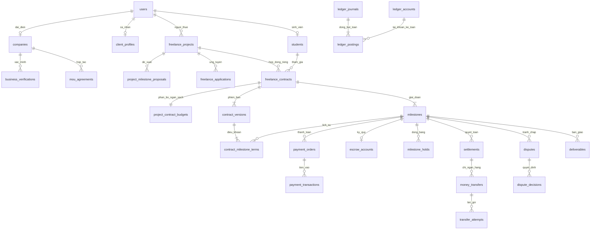

# Đặc tả backend và database Freelancer — payOS, tiền thật, không ví

**Phiên bản:** 2.2 — bổ sung bộ nền thực thi theo yêu cầu chủ dự án ngày 04/11/2026.

**Trạng thái:** Chủ dự án đã duyệt các quyết định mục 19, với điều chỉnh: một dự án có nhiều sinh viên, mỗi sinh viên một hợp đồng và luồng quyết toán riêng. Đã yêu cầu triển khai phần dùng chung: model, migration 0002, DTO/ports và fixtures đã được chuẩn bị; migration chỉ thử trên DB kiểm thử. Chưa áp dụng lên DB đang dùng hoặc tích hợp payOS thật. Xem [FOUNDATION_STATUS.md](freelancer/FOUNDATION_STATUS.md).

**Mục đích:** Thống nhất nghiệp vụ, cấu trúc dữ liệu và ranh giới triển khai cho nhóm phát triển Student Connect. Tài liệu này thay thế các phương án sandbox, ví mô phỏng, nhiều provider và thanh toán gộp trong bản `FREELANCER_DATABASE_DESIGN_REVIEW.md`. Bản HTML cũ không phản ánh các quyết định mới này.

**Giới hạn:** Đây là đặc tả thiết kế, không phải xác nhận tài khoản payOS đã được cấp quyền chi hộ hoặc mô hình thu/giữ/chi tiền đã được đối tác chấp thuận. Hoàn thành phần mềm không tự động đồng nghĩa đủ điều kiện vận hành tiền của người dùng.

## Mục lục

1. [Phạm vi và quyết định thiết kế](#1-phạm-vi-và-quyết-định-thiết-kế)
2. [Luồng nghiệp vụ và chính sách](#2-luồng-nghiệp-vụ-và-chính-sách)
3. [Quy ước database](#3-quy-ước-database)
4. [Sơ đồ quan hệ](#4-sơ-đồ-quan-hệ)
5. [Tài khoản và xác minh doanh nghiệp](#5-tài-khoản-và-xác-minh-doanh-nghiệp)
6. [Dự án và ứng tuyển](#6-dự-án-và-ứng-tuyển)
7. [Hợp đồng, milestone và bàn giao](#7-hợp-đồng-milestone-và-bàn-giao)
8. [Thanh toán và ký quỹ](#8-thanh-toán-và-ký-quỹ)
9. [Ledger và dòng tiền](#9-ledger-và-dòng-tiền)
10. [Quyết toán, giải ngân và hoàn tiền](#10-quyết-toán-giải-ngân-và-hoàn-tiền)
11. [Hủy, tranh chấp và đóng băng](#11-hủy-tranh-chấp-và-đóng-băng)
12. [Trạng thái chuẩn](#12-trạng-thái-chuẩn)
13. [Transaction và idempotency](#13-transaction-và-idempotency)
14. [Audit, worker và đối soát](#14-audit-worker-và-đối-soát)
15. [API và phân quyền](#15-api-và-phân-quyền)
16. [Tương thích và migration](#16-tương-thích-và-migration)
17. [Phân việc và tiêu chí nghiệm thu](#17-phân-việc-và-tiêu-chí-nghiệm-thu)
18. [Điều kiện trước khi mở tiền thật](#18-điều-kiện-trước-khi-mở-tiền-thật)
19. [Nguồn và quyết định đã duyệt](#19-nguồn-và-quyết-định-đã-duyệt)

## 1. Phạm vi và quyết định thiết kế

### 1.1. Các quyết định đã được người dùng xác nhận

- Mỗi doanh nghiệp có **một tài khoản đại diện**; giữ `companies.user_id UNIQUE`.
- Một dự án có thể có nhiều sinh viên; **mỗi sinh viên có một hợp đồng riêng**, với milestone, ký quỹ, nghiệm thu, giải ngân, hoàn tiền và tranh chấp riêng.
- MOU được ký ngoài hệ thống, tải bản đã ký lên để Admin kiểm tra. Chưa tích hợp dịch vụ ký từ xa.
- Tập trung tích hợp **payOS và tiền thật**; sản phẩm không có nút giả lập thanh toán hoặc ví mô phỏng.
- Không có ví nạp/rút của người dùng. Tiền được theo dõi theo dự án, hợp đồng và milestone.
- Người thuê và sinh viên vẫn có màn hình xem ký quỹ, giải ngân, hoàn tiền và lịch sử giao dịch.
- Chỉ thay đổi tài liệu ở giai đoạn này; model/migration cần được duyệt riêng sau thiết kế.

### 1.2. Phương án được thống nhất

- Role giữ `STUDENT/COMPANY/ADMIN`, thêm `CLIENT` cho người thuê cá nhân. Một tài khoản có một role; không triển khai chuyển role hoặc nhiều role.
- Một dự án chọn nhiều sinh viên, mỗi cặp `(project_id, freelancer_student_id)` có tối đa một hợp đồng. Không thay sinh viên trên hợp đồng cũ; hợp đồng bị hủy vẫn giữ lịch sử.
- Các hợp đồng độc lập về công việc và tài chính. Không tự chia một khoản tiền dự án cho nhiều sinh viên; client cấp vốn từng milestone thuộc đúng hợp đồng.
- Một lần thanh toán cấp vốn đúng một milestone; không thanh toán gộp hoặc nạp ví.
- Một milestone chỉ nhận một lần cấp vốn thành công. Khoản chuyển lặp/thừa/thiếu/trễ vào kiểm tra, không tự cộng vào milestone.
- Dự án nhỏ dùng chính sách cấp đủ toàn hợp đồng trước khi làm; dự án chia giai đoạn có thể cấp từng milestone. Ngưỡng phân loại là cấu hình.
- Phí nền tảng mặc định 500 basis point (5%), trừ trên phần gross được giải ngân; tỷ lệ và điều khoản được chụp trong hợp đồng.
- Tự nghiệm thu và giải ngân theo thời hạn được hai bên chấp nhận. Tranh chấp hoặc lệnh đóng băng còn hiệu lực ngăn chi tự động.
- Giải ngân/hoàn tiền đi thẳng đến tài khoản ngân hàng đã được kiểm tra; không có nút rút tiền hay số dư có thể sử dụng để trả hợp đồng khác.
- Phí ngân hàng/provider do nền tảng chịu trong phiên bản này, ghi chi phí riêng; không tự trừ vào tiền đã hứa trả sinh viên hoặc hoàn client.
- Vẫn dùng test double/mock trong kiểm thử tự động. Chúng không phải chế độ tài chính của sản phẩm, không tạo giao dịch giả trong DB production.

### 1.3. Phần không triển khai trong bản đầu

Đa tiền tệ, hợp đồng chung cho một nhóm freelancer, ví nội bộ, rút tiền, nạp tiền dùng chung, thanh toán gộp, nhiều cổng thanh toán, ký MOU trực tiếp trên web, hệ thống chat thời gian thực, khấu trừ thuế tự động và xuất hóa đơn tự động.

Chat chưa có: đề xuất/báo giá/tiêu chí/sửa bài phải được ghi nhận bằng các thao tác có cấu trúc và ghi chú. Bằng chứng trao đổi bên ngoài có thể nộp qua tranh chấp, nhưng không được mô tả như lịch sử tin nhắn đã xác minh bởi nền tảng.

## 2. Luồng nghiệp vụ và chính sách

### 2.1. Luồng thành công

```text
Đăng ký / đăng nhập → xác minh liên hệ hoặc doanh nghiệp
→ tạo dự án và milestone dự kiến → Admin duyệt
→ nhiều sinh viên ứng tuyển → người thuê chọn từng sinh viên
→ tạo hợp đồng riêng + milestone riêng cho mỗi người → hai bên chấp nhận cùng phiên bản
→ người thuê thanh toán từng milestone qua payOS
→ backend xác nhận tiền và ghi ledger → milestone FUNDED
→ sinh viên bắt đầu → nộp sản phẩm → người thuê nghiệm thu
→ tạo quyết toán → chi đến tài khoản sinh viên → xác nhận chi thành công
→ cập nhật lịch sử tài chính và kết thúc từng hợp đồng khi đủ điều kiện
→ đóng tuyển và kết thúc dự án khi tất cả hợp đồng/nghĩa vụ đã được xử lý.
```

### 2.2. Quyền và xác minh

| Đối tượng | Điều kiện | Quyền |
|---|---|---|
| CLIENT chưa xác minh email | Tài khoản hợp lệ | Hoàn thiện hồ sơ, xác minh liên hệ. |
| CLIENT đã xác minh email | Email hiện tại đã xác minh | Tạo nháp dự án. |
| CLIENT đã xác minh email và SĐT | CONTACT_VERIFIED tính từ timestamps | Gửi duyệt dự án; ký hợp đồng và thanh toán khi hợp lệ. |
| COMPANY chưa xác minh pháp nhân | Được đăng nhập onboarding | Nộp/sửa hồ sơ, xem kết quả; chưa gửi dự án freelance. |
| COMPANY VERIFIED | Người đại diện được kiểm tra, không đình chỉ | Dự án theo hạn mức, cấp vốn đầy đủ trước làm nếu policy yêu cầu. |
| COMPANY có MOU hiệu lực | VERIFIED + MOU hợp lệ + không đình chỉ | Hạng đối tác, hạn mức/policy tương ứng; vẫn cần ký quỹ. |
| STUDENT | Tài khoản ACTIVE, hồ sơ sinh viên đủ điều kiện của trường | Ứng tuyển, ký hợp đồng, giao việc, nhận tiền. |
| ADMIN | Tài khoản ACTIVE và có quyền chức năng | Duyệt hồ sơ, dự án, xử lý tranh chấp/đối soát. |

OTP chứng minh kiểm soát kênh liên hệ ở thời điểm xác nhận, không thay thế xác minh danh tính hoặc quyền ký của doanh nghiệp. Quyền tài chính luôn kiểm tra ownership ở backend.

### 2.3. MOU và đình chỉ

- MOU upload phải có người ký, căn cứ thẩm quyền, phạm vi, thời hạn, file gốc/hash và người kiểm tra. Bản scan có kiểm tra thủ công không được gắn nhãn “đã xác thực chữ ký số”.
- MOU hết hạn chỉ dừng quyền theo MOU. Doanh nghiệp vẫn VERIFIED được trở về hạng chưa MOU và hạn mức tương ứng, không chặn vô thời hạn chỉ vì từng có MOU. Chính sách điều chỉnh so với bản cũ này đã được chủ dự án duyệt.
- Khi đình chỉ: chặn dự án/ký quỹ mới, tạo lệnh đóng băng cho các khoản chưa chi, Admin xử lý hợp đồng còn lại. Không cố đảo một lệnh đã gửi ngân hàng; UNKNOWN/PENDING phải đối soát.
- Hết hạn MOU không tự đóng băng tiền/hủy hợp đồng cũ.

### 2.4. Màn hình tài chính không cần ví

Mỗi hợp đồng hiển thị: giá trị, tổng tiền được cấp vốn, đang giữ, đang xử lý chi, đã giải ngân gross, sinh viên thực nhận net, phí nền tảng, đã hoàn và khoản đang kiểm tra. Milestone chưa có tiền không hiển thị “đã bảo đảm thanh toán”.

Trang “Thanh toán & ký quỹ” tổng hợp các hợp đồng người dùng có quyền xem. Không cộng khoản thu chưa phân bổ thành tiền đã ký quỹ. Chủ dự án xem tổng dự án và chi tiết từng hợp đồng; mỗi sinh viên chỉ xem hợp đồng và tài chính của mình, không xem báo giá, giấy tờ nhận tiền, hợp đồng hoặc thu nhập của sinh viên khác.

## 3. Quy ước database

Stack giữ FastAPI + SQLAlchemy + MariaDB 10.11/InnoDB + Alembic. Bảng tuyển dụng/thực tập hiện có được bảo toàn.

| Ký hiệu | Kiểu / quy tắc |
|---|---|
| ID | BIGINT UNSIGNED; cùng helper ID hiện tại. |
| MONEY | BIGINT có dấu, CHECK >= 0; nghiệp vụ yêu cầu dương thêm CHECK > 0. |
| BP | SMALLINT UNSIGNED, CHECK 0..10000; policy phí bản đầu <10000. |
| DT | DATETIME(6), UTC. DATE dùng cho ngày lịch đã xác định múi giờ. |
| HASH | CHAR(64), hex SHA-256; dữ liệu ít entropy như OTP/fingerprint dùng HMAC với key ngoài DB. |
| `?` | Nullable; không có `?` là NOT NULL. |
| C / CU | created_at / created_at + updated_at; DT, mặc định thời điểm tạo/cập nhật. |
| UQ / IX | Unique constraint / index ngoài PK. |
| TX | Ràng buộc cần kiểm tra bằng service trong transaction có khóa. |

Mỗi bảng mới có `id ID PK` tự tăng và nhóm thời gian ghi bên cạnh tên, trừ bảng có PK khác được nêu rõ. Cột FK luôn ghi bảng đích. Các cột không nêu default phải được truyền tường minh, không tự đặt default làm thay đổi ý nghĩa tiền hoặc phê duyệt.

Trạng thái mới dùng VARCHAR(40) + CHECK, enum Python dùng chung. Đây là thay đổi quy ước cho bảng mới so với native ENUM hiện tại, đã được duyệt về thiết kế. Cột role cũ mở rộng enum bằng migration tương thích.

FK mới mặc định ON DELETE RESTRICT. Không xóa cứng chứng từ, tài chính hoặc hợp đồng. Phiên bản/nhật ký/file đã nộp không cascade-delete. Khóa tài khoản có giao dịch thay vì xóa. Kiểm tra tương tác với cascade của bảng cũ trước migration.

Tiền và ID bảng mới truyền dưới dạng chuỗi số trong JSON API để tránh mất chính xác ở JavaScript; backend dùng int. API cũ giữ nguyên đến khi có kế hoạch thay đổi riêng.

Email lowercase; SĐT E.164; MST chuẩn hóa. Hash, key, mã tham chiếu provider dùng collation phân biệt hoa/thường. Nội dung người dùng utf8mb4. FK được index nếu chưa có index ghép bắt đầu bằng cột đó. Không dùng JSON thay cho số tiền, trạng thái hoặc FK có thể khai báo trực tiếp.

Thời hạn dùng giây trong snapshot hợp đồng, không hardcode ngày vào logic. Tiền chỉ VND. Khóa API/checksum key, OTP secret, encryption key không nằm trong bảng nghiệp vụ hoặc source control.

## 4. Sơ đồ quan hệ



Sơ đồ lược bớt các FK actor, file và lịch sử; từ điển dữ liệu bên dưới quy định đầy đủ.

## 5. Tài khoản và xác minh doanh nghiệp

### 5.1. Thay đổi `users` hiện có

Giữ email UNIQUE, password và quan hệ hồ sơ; thêm role CLIENT, `phone VARCHAR(20)?`, `email_verified_at DT?`, `phone_verified_at DT?`.

`users.status` tiếp tục là PENDING_ACTIVATION/PENDING_APPROVAL/ACTIVE/LOCKED, chỉ kiểm soát tài khoản. Onboarding cần dependency xác thực giới hạn để tài khoản chờ duyệt có thể sửa/nộp hồ sơ; không nới quyền toàn bộ router cũ. Thay email/phone xóa xác minh tương ứng và vô hiệu challenge cũ trong TX.

### 5.2. `client_profiles` — CU

`user_id FK users UQ`, `full_name VARCHAR(255)`, `address VARCHAR(500)?`.

TX user.role=CLIENT. Không tạo profile này cho COMPANY/STUDENT. Tên người nhận hoàn tiền phải được kiểm tra theo chính sách nhận tiền, không coi tên tự khai là đã KYC.

### 5.3. `user_verifications` — CU

`user_id FK users`, `channel VARCHAR(10) EMAIL/PHONE`, `purpose VARCHAR(30) VERIFY_CONTACT/CHANGE_CONTACT`, `target VARCHAR(255)`, `otp_hash HASH`, `key_version VARCHAR(30)`, `status VARCHAR(20) PENDING/VERIFIED/EXPIRED/LOCKED/SUPERSEDED`, `attempts SMALLINT UNSIGNED default 0`, `max_attempts SMALLINT UNSIGNED`, `expires_at DT`, `resend_after DT`, `verified_at DT?`.

IX `(user_id,channel,created_at)`, `(status,expires_at)`; CHECK max_attempts>0, attempts<=max_attempts. Khóa user khi phát OTP; chỉ một PENDING/channel/purpose, bản cũ SUPERSEDED. Khóa challenge khi kiểm tra, tăng attempts kể cả sai mã. Giới hạn theo user/target/IP ở kho chia sẻ hoặc DB, không chỉ RAM một process. Production không trả OTP hoặc ghi OTP thô vào log.

### 5.4. Thay đổi `companies` hiện có

Giữ `user_id UQ`, `tax_code UQ`, thông tin cũ. Thêm:

| Cột | Kiểu / default |
|---|---|
| legal_name | VARCHAR(255)? khi backfill, bắt buộc trước gửi xác minh |
| representative_name / representative_position | VARCHAR(255)? / VARCHAR(100)? |
| is_legal_representative | BOOLEAN? |
| authorization_file_id | FK stored_files? |
| business_status | VARCHAR(40), UNVERIFIED |
| business_verified_at / business_verified_by | DT? / FK users? |
| operation_status | VARCHAR(20), ENABLED; ENABLED/SUSPENDED |
| suspension_reason / suspended_at / suspended_by | TEXT? / DT? / FK users? |

business_status: UNVERIFIED/PENDING_VERIFICATION/NEEDS_REVISION/VERIFIED/REJECTED/REVOKED. IX `(business_status,created_at)`.

Giữ `verification_status` cũ cho tuyển dụng trong giai đoạn tương thích. APPROVED cũ không tự thành VERIFIED mới hoặc đối tác MOU. Không có organizations, organization_members hoặc recruiter/owner phụ.

### 5.5. `business_verifications` — CU

`company_id FK companies`, `submission_no INT UNSIGNED`, `submitted_by FK users`, `submitted_snapshot JSON`, `status VARCHAR(30) PENDING/NEEDS_REVISION/APPROVED/REJECTED`, `decided_by FK users?`, `decided_at DT?`, `reason TEXT?`.

UQ `(company_id,submission_no)`, IX `(status,created_at)`. TX chỉ đại diện của company nộp; mỗi lần nộp lại tạo bản mới, chỉ một PENDING dưới khóa company. APPROVED phải có Admin quyết định và kiểm tra pháp nhân/quyền đại diện; không tự duyệt chỉ vì email cùng tên miền. Bản đầu kiểm tra thủ công, chưa tích hợp tra cứu doanh nghiệp tự động.

### 5.6. `business_verification_files` — C, không có id

PK `(verification_id FK business_verifications,file_id FK stored_files)`, `document_type VARCHAR(40) BUSINESS_LICENSE/TAX_CERTIFICATE/AUTHORIZATION/OTHER`.

### 5.7. `company_limits` — CU

`company_id FK companies UQ`, `max_open_projects INT UNSIGNED`, `max_project_amount MONEY`, `max_daily_funding MONEY`, `full_prefunding_required BOOLEAN`, `source VARCHAR(20) VERIFIED/PARTNER/OVERRIDE`, `set_by FK users?`, `reason TEXT?`.

CHECK các hạn mức>0. Policy là cấu hình; lưu giá trị áp dụng, thay đổi có audit. Việc gửi dự án đồng thời khóa company trước khi đếm. Không dùng MOU thay nghĩa vụ cấp vốn.

### 5.8. `mou_agreements` — CU

`company_id FK companies`, `agreement_code VARCHAR(100) UQ`, `document_file_id FK stored_files`, `school_name VARCHAR(255)`, `school_signer_name VARCHAR(255)`, `school_signer_position VARCHAR(100)`, `company_signer_name VARCHAR(255)`, `company_signer_position VARCHAR(100)`, `company_authority_file_id FK stored_files?`, `school_authority_file_id FK stored_files?`, `signature_method VARCHAR(30) SCANNED_SIGNED_DOCUMENT/EXTERNALLY_DIGITALLY_SIGNED`, `signature_verification_status VARCHAR(30) NOT_CHECKED/MANUALLY_REVIEWED/CRYPTOGRAPHICALLY_VERIFIED/FAILED`, `signed_at DT`, `effective_from DT`, `effective_until DT`, `scope_json JSON`, `status VARCHAR(20) PENDING_REVIEW/ACTIVE/REJECTED/EXPIRED/REVOKED/SUPERSEDED`, `reviewed_by FK users?`, `reviewed_at DT?`, `review_note TEXT?`.

CHECK effective_until>effective_from. IX `(company_id,status,effective_until)`, `(status,effective_until)`. Một MOU ACTIVE/company dưới khóa company. ACTIVE yêu cầu VERIFIED, thẩm quyền hai bên đã kiểm tra và đúng thời hạn. Tải file khác hoặc sửa phạm vi/thời hạn sau duyệt phải tạo bản mới, không sửa hồ sơ ACTIVE trực tiếp.

Mặc định bản đầu chỉ MANUALLY_REVIEWED; không có công cụ xác thực mật mã thì không được ghi CRYPTOGRAPHICALLY_VERIFIED. OFFICIAL_PARTNER là giá trị tính, không phải cờ có thể mâu thuẫn với hạn MOU. Nhà trường là một tenant hiện tại, chưa cần tạo bảng schools.

`company_documents` cũ thêm `stored_file_id FK stored_files?`, `uploaded_by FK users?` khi chuyển đổi; không xóa file_url cũ ngay.

### 5.9. `stored_files` — C

`uploaded_by FK users`, `storage_key VARCHAR(500) UQ`, `original_name VARCHAR(255)`, `content_type VARCHAR(150)`, `size_bytes BIGINT`, `checksum_sha256 HASH`, `category VARCHAR(40)`, `scan_status VARCHAR(20) PENDING/CLEAN/REJECTED`, `availability_status VARCHAR(20) AVAILABLE/QUARANTINED/REMOVED`.

CHECK size_bytes>0. IX `(uploaded_by,created_at)`, `(checksum_sha256)`. Không UQ checksum. File phải CLEAN/AVAILABLE trước khi gắn chứng cứ; API tải file kiểm tra quyền theo hồ sơ liên quan, không chỉ possession file_id. Không lộ public URL giấy tờ, tài khoản ngân hàng hoặc bằng chứng. Không sửa nội dung storage_key sau khi được dùng trong hợp đồng/bằng chứng.

## 6. Dự án và ứng tuyển

### 6.1. `freelance_projects` — CU

`client_user_id FK users`, `company_id FK companies?`, `title VARCHAR(255)`, `description TEXT`, `budget_amount MONEY`, `max_students INT UNSIGNED`, `recruitment_status VARCHAR(20) NOT_OPEN/OPEN/CLOSED`, `recruitment_closed_at DT?`, `deadline DT`, `acceptance_criteria TEXT`, `deliverables_description TEXT`, `funding_policy VARCHAR(20) FULL/PER_MILESTONE`, `status VARCHAR(40)`, `submitted_at DT?`, `reviewed_by FK users?`, `reviewed_at DT?`, `review_reason TEXT?`, `closed_at DT?`.

CHECK budget_amount>0, max_students>0. IX `(client_user_id,status)`, `(company_id,status)`, `(status,recruitment_status,created_at)`. TX CLIENT=>company_id NULL; COMPANY=>company_id đúng hồ sơ của user; role khác không đăng. Chỉ nhận ứng tuyển khi status APPROVED/IN_PROGRESS và recruitment_status OPEN. Chọn một sinh viên không tự đóng tuyển toàn dự án. Sau hợp đồng có hiệu lực, thay nghĩa vụ bằng version hợp đồng, không sửa project để thay điều khoản đã ký.

`budget_amount` là tổng trần ngân sách cho tất cả hợp đồng của dự án, không phải mức trả cho mỗi sinh viên. `max_students` là trần số hợp đồng chưa CANCELLED; tăng trần người/ngân sách sau duyệt phải được Admin duyệt lại phần thay đổi, không sửa nghĩa vụ hợp đồng đang chạy. Chủ dự án có thể đóng tuyển sớm; muốn mở lại phải còn ngân sách/chỗ và dự án chưa terminal.

### 6.2. `project_milestone_proposals` — CU

`project_id FK freelance_projects`, `sequence_no INT UNSIGNED`, `title VARCHAR(255)`, `amount MONEY`, `acceptance_criteria TEXT`, `due_at DT`.

UQ `(project_id,sequence_no)`, CHECK amount>0. Tổng tiền proposal bằng budget_amount khi gửi duyệt; ngày hợp lệ với deadline dự án. Proposal mô tả các giai đoạn và ngân sách dự kiến của **toàn dự án**, không tự nhân bản số tiền cho mỗi sinh viên. Khi tạo từng hợp đồng, hai bên chốt phạm vi và milestone riêng trong phần ngân sách phân bổ; không bắt buộc tổng hợp đồng của một người bằng tổng proposal. Mặc định dự án nhỏ tạo một proposal.

### 6.3. `freelance_project_skills` — không có id, không timestamps

PK `(project_id FK freelance_projects,skill_id FK skills)`, `is_required BOOLEAN default true`.

### 6.4. `freelance_project_reviews` — C

`project_id FK freelance_projects`, `reviewed_by FK users`, `decision VARCHAR(30) APPROVED/NEEDS_REVISION/REJECTED`, `reason TEXT`, `project_snapshot JSON`.

IX `(project_id,created_at)`. Append-only; lưu cả proposal snapshot để biết Admin đã duyệt nội dung nào.

### 6.5. `freelance_applications` — CU

`project_id FK freelance_projects`, `student_id FK students`, `proposal TEXT`, `quoted_amount MONEY`, `estimated_days INT UNSIGNED`, `cv_id FK cvs?`, `cv_snapshot_file_id FK stored_files?`, `status VARCHAR(20) SUBMITTED/SHORTLISTED/SELECTED/REJECTED/WITHDRAWN`, `selected_at DT?`.

UQ `(project_id,student_id)`; IX `(student_id,status,created_at)`, `(project_id,status)`. CHECK quoted_amount>0, estimated_days>0. Chọn người dưới khóa project, kiểm tra còn chỗ và ngân sách; cho phép nhiều application SELECTED thuộc các sinh viên khác nhau. quoted_amount là báo giá cho phần công việc của ứng viên, không phải giá toàn dự án. Một người không thể ứng tuyển dự án do chính user mình đăng. Bản đầu không nộp lại đơn WITHDRAWN; không đổi sinh viên trên hợp đồng đã tạo. Có thể chọn sinh viên khác để thực hiện phần việc mới nếu còn ngân sách/chỗ.

### 6.6. Ngân sách dự án và tuyển nhiều sinh viên

**`project_contract_budgets` — CU:** `project_id ID`, `contract_id ID UQ`, `allocated_amount MONEY`, `status VARCHAR(20) RESERVED/COMMITTED/RELEASED`, `committed_at DT?`, `released_at DT?`.

FK project_id → freelance_projects; FK ghép `(project_id,contract_id)` → freelance_contracts(project_id,id). CHECK allocated_amount>0. IX `(project_id,status)`. Một bản ghi cho một hợp đồng, tạo cùng TX chọn ứng viên/tạo hợp đồng. Đây là phân bổ ngân sách thương lượng, **không phải tiền đã nhận hoặc ký quỹ** và không tạo ledger.

- Tại chọn người: request có `application_id` và `allocated_amount`; khóa project, kiểm tra tổng allocation RESERVED+COMMITTED không vượt budget_amount và số hợp đồng chưa CANCELLED không vượt max_students. Không chọn nhiều người rồi mới kiểm tra ngân sách bên ngoài TX.
- DRAFT/PENDING_ACCEPTANCE: RESERVED; tổng amount của mọi version được OFFERED phải <=allocated_amount. Muốn tăng allocation khóa project trước contract và kiểm tra trần. Giảm được khi chưa có bản OFFERED còn hiệu lực và không thấp hơn nghĩa vụ hiện hành.
- Khi hợp đồng ACTIVE: allocation COMMITTED, total_amount của bản hiệu lực phải <=allocated_amount. Có thể thu hẹp allocation về total_amount trong chính TX kích hoạt đầu tiên.
- Sau ACTIVE: tăng tổng hợp đồng phải tăng allocation trước/cùng TX dưới khóa project; bản OFFERED mới phải được bảo đảm ngân sách trước khi gửi. Bản đầu không tự thu hồi phần COMMITTED sau hoàn tiền/TERMINATED để tái sử dụng; giữ mức đã cam kết cho lịch sử và kiểm soát trần bảo thủ. Khoản chưa cấp vốn không được hiển thị là tiền đang giữ.
- CANCELLED trước ACTIVE: RELEASED, giải phóng ngân sách và chỗ; không xóa hợp đồng. TERMINATED/COMPLETED vẫn giữ phần COMMITTED và được tính vào trần sinh viên đã tham gia. Muốn thêm người vượt trần cần tăng max_students theo luồng duyệt.
- Không tự chuyển tiền ký quỹ của hợp đồng A sang B. Muốn dùng phần tiền được hoàn để trả hợp đồng khác, client nhận hoàn rồi tạo thanh toán mới.

Ví dụ dự án trần 10.000.000đ, max_students=3: A 4.000.000đ, B 3.000.000đ, C 3.000.000đ; mỗi người có hợp đồng và milestone riêng. Hai lần chọn đồng thời không được làm tổng vượt 10.000.000đ. A hoàn tất không làm hợp đồng B/C tự nghiệm thu hoặc dự án tự COMPLETED.

Không sửa bảng `applications` hiện có vì bảng đó gắn `jobs` và luồng tuyển dụng.

## 7. Hợp đồng, milestone và bàn giao

### 7.1. `freelance_contracts` — CU

`project_id FK freelance_projects`, `application_id FK freelance_applications UQ`, `client_user_id FK users`, `company_id FK companies?`, `freelancer_student_id FK students`, `status VARCHAR(30) DRAFT/PENDING_ACCEPTANCE/ACTIVE/COMPLETED/CANCELLED/TERMINATED`, `effective_version_id FK contract_versions?`, `activated_at DT?`, `closed_at DT?`, `closure_reason TEXT?`.

UQ `(project_id,freelancer_student_id)`, UQ `(project_id,id)` cho FK ghép ngân sách. IX `(client_user_id,status)`, `(freelancer_student_id,status)`, `(project_id,status)`. Không UNIQUE riêng project_id. TX application thuộc project, là SELECTED, student và client đúng; user hai bên khác nhau. Giữ UQ application_id để một đơn không tạo hai hợp đồng. Tạo cùng TX với project_contract_budgets; request chọn cùng ứng viên lặp trả hợp đồng cũ nếu cùng nội dung, không tạo bản thứ hai.

Các version, terms, milestones, order, escrow, settlement và transfer luôn thuộc hợp đồng cụ thể. FULL nghĩa cấp đủ milestone của **hợp đồng đó**, không chờ tất cả hợp đồng của dự án. Tranh chấp của A không chặn B/C trừ có hold chung do đình chỉ/chính sách Admin.

Vòng FK effective_version_id khai báo sau khi tạo contract_versions. Dùng FK ghép `(id,effective_version_id)` → `contract_versions(contract_id,id)` để chặn trỏ version của hợp đồng khác. MariaDB cho phép FK ghép có nullable thành phần; NULL nghĩa chưa có bản hiệu lực.

### 7.2. `contract_versions` — CU

`contract_id FK freelance_contracts`, `version_no INT UNSIGNED`, `created_by FK users`, `status VARCHAR(20) DRAFT/OFFERED/EFFECTIVE/DECLINED/WITHDRAWN/SUPERSEDED/EXPIRED`, `total_amount MONEY`, `fee_rate_bp BP`, `review_period_seconds INT UNSIGNED`, `max_revision_count SMALLINT UNSIGNED`, `grace_period_seconds INT UNSIGNED`, `funding_policy VARCHAR(20) FULL/PER_MILESTONE`, `terms_json JSON`, `content_hash HASH?`, `offered_at DT?`, `acceptance_deadline DT?`, `client_accepted_at DT?`, `freelancer_accepted_at DT?`, `effective_at DT?`, `response_note TEXT?`.

UQ `(contract_id,version_no)`, UQ `(contract_id,id)` cho FK ghép. CHECK total>0, review_period>0, fee_rate<10000. Khóa contract khi cấp version_no và chấp nhận. Bản OFFERED đóng băng nội dung/terms; content_hash bắt buộc trước OFFERED. Chỉ sửa metadata phản hồi/trạng thái.

Hai bên có thể đề xuất bản DRAFT mới; chỉ một bản OFFERED chưa hết hạn/contract, kiểm tra dưới khóa contract. Bản mới không vô hiệu nghĩa vụ EFFECTIVE cũ cho đến khi cả hai chấp nhận đúng content_hash/version. Chấp nhận lần hai tạo EFFECTIVE trong TX; bản cũ SUPERSEDED nhưng giữ nguyên nội dung. Hết hạn/từ chối không làm dừng hợp đồng ACTIVE cũ.

terms_json chụp danh tính/tên hai bên, chính sách phí/hoàn/hủy/tranh chấp, deadline nghiệm thu, quy tắc tự nghiệm thu, cấu hình cấp vốn và phạm vi công việc. Không coi JSON là nơi duy nhất lưu amount/fee dùng để tính tiền.

### 7.3. `milestones` — CU

`contract_id FK freelance_contracts`, `sequence_no INT UNSIGNED`, `effective_terms_id FK contract_milestone_terms?`, `status VARCHAR(40)`, `started_at DT?`, `submitted_at DT?`, `review_deadline DT?`, `revision_count SMALLINT UNSIGNED default 0`, `accepted_at DT?`, `acceptance_source VARCHAR(20)? MANUAL/AUTO/DISPUTE`, `settled_at DT?`.

UQ `(contract_id,sequence_no)`, UQ `(contract_id,id)`, IX `(status,review_deadline)`. FK ghép `(id,effective_terms_id)` → contract_milestone_terms(milestone_id,id), tạo sau các bảng; ngăn terms của milestone khác.

### 7.4. `contract_milestone_terms` — C

`contract_id ID`, `contract_version_id ID`, `milestone_id ID`, `title VARCHAR(255)`, `description TEXT?`, `amount MONEY`, `acceptance_criteria TEXT`, `due_at DT`, `included BOOLEAN default true`.

FK ghép `(contract_id,contract_version_id)` → contract_versions(contract_id,id); `(contract_id,milestone_id)` → milestones(contract_id,id). UQ `(contract_version_id,milestone_id)`, UQ `(milestone_id,id)`. CHECK amount>0. TX tổng amount included=true bằng version.total_amount.

Nguồn amount/title/criteria/due_at là terms, không lưu một bộ mutable khác trên milestones. Terms trong OFFERED/EFFECTIVE bất biến. Milestone đang có order chưa đóng, tiền đang kiểm tra, đã FUNDED hoặc đã bắt đầu không được thay amount/criteria/due_at/phí áp dụng; scope tăng thêm tạo milestone mới. Snapshot fee lấy từ version gắn terms của milestone, không từ cấu hình mới.

### 7.5. `deliverables` — C

`milestone_id FK milestones`, `submission_no INT UNSIGNED`, `submitted_by FK users`, `note TEXT?`, `submitted_at DT`.

UQ `(milestone_id,submission_no)`, UQ `(milestone_id,id)`. Bảng `deliverable_files`: PK `(deliverable_id FK deliverables,file_id FK stored_files)`, C, không id. Mỗi lần nộp giữ nguyên, có ít nhất một file sạch hoặc nội dung bàn giao đáp ứng policy. Không sửa/xóa bản nộp để thay chứng cứ.

### 7.6. `milestone_reviews` — C

`milestone_id ID`, `deliverable_id ID`, `reviewed_by FK users?`, `action VARCHAR(30) ACCEPT/REQUEST_REVISION/AUTO_ACCEPT`, `reason TEXT?`, `reviewed_at DT`.

FK ghép `(milestone_id,deliverable_id)` → deliverables(milestone_id,id). IX `(milestone_id,created_at)`. Chỉ bản nộp mới nhất đang SUBMITTED được review; REQUEST_REVISION yêu cầu lý do và tăng revision_count dưới lock. AUTO_ACCEPT actor NULL, phải truy được job. Review và tạo settlement release trong cùng TX khi đủ điều kiện.

### 7.7. `freelance_reviews` — C

`contract_id FK freelance_contracts`, `reviewer_user_id FK users`, `reviewee_user_id FK users`, `rating SMALLINT UNSIGNED`, `comment TEXT?`, `visibility VARCHAR(20) VISIBLE/HIDDEN`.

UQ `(contract_id,reviewer_user_id)`, CHECK rating 1..5 và reviewer!=reviewee. Chỉ hai bên hợp đồng terminal, có phần công việc đã được trả tiền mới đánh giá. Admin ẩn có lý do/audit, không sửa lời đánh giá.

## 8. Thanh toán và ký quỹ

### 8.1. `payment_orders` — CU

`milestone_id FK milestones`, `payer_user_id FK users`, `expected_amount MONEY`, `order_code BIGINT UQ`, `payment_link_id VARCHAR(191)? UQ`, `status VARCHAR(30) CREATING/PENDING/PROCESSING/PAID/EXPIRED/CANCELLED/FAILED/NEEDS_REVIEW/UNKNOWN`, `request_key VARCHAR(128)`, `request_hash HASH`, `checkout_url VARCHAR(1000)?`, `qr_payload TEXT?`, `receiving_account_snapshot JSON`, `expires_at DT`, `paid_at DT?`, `provider_response_json JSON?`.

UQ `(payer_user_id,request_key)`, IX `(milestone_id,created_at)`, `(status,expires_at)`. CHECK expected_amount>0; order_code nằm trong miền số nguyên an toàn của API/SDK được xác nhận, không lấy timestamp đơn giản làm mã chống trùng. Một mã được cấp từ sequence/generator đảm bảo unique, không tái sử dụng.

Timeout tạo link giữ UNKNOWN và tra cứu theo order_code trước retry; không tạo order mới mù. Return URL/cancel URL của trình duyệt không chứng minh tiền đã vào hoặc đơn chưa có tiền.

### 8.2. `milestone_funding_guards` — C, không id

`milestone_id PK/FK milestones`, `payment_order_id FK payment_orders UQ`.

Một order đang chờ xử lý/milestone. Tạo/xóa guard dưới khóa milestone. Chỉ giải phóng khi đã biết chắc order không còn cấp vốn, không có tiền đang chờ review hoặc callback chưa đối soát. Hết đếm ngược UI không đủ để mở order mới.

### 8.3. `provider_events` — CU

`channel_key VARCHAR(100)`, `event_key VARCHAR(191)`, `event_type VARCHAR(20) PAYMENT/PAYOUT`, `payload_hash HASH`, `payload_json JSON`, `status VARCHAR(20) RECEIVED/PROCESSING/PROCESSED/UNMATCHED/RETRY/DEAD/PROBE`, `attempts INT UNSIGNED default 0`, `available_at DT`, `lease_until DT?`, `last_error TEXT?`, `processed_at DT?`.

UQ `(channel_key,event_key)`, IX `(status,available_at,lease_until)`. channel_key là định danh cấu hình merchant/kênh, không phải secret. payOS không được giả định luôn có event_id: adapter tạo event_key ổn định từ các trường giao dịch đã xác minh hoặc hash canonical payload. Dedupe tài chính vẫn dựa external transaction reference, không chỉ hash webhook.

Xác minh signature trước khi lưu vào hàng đợi hợp lệ. Probe/xác nhận webhook của provider không được tạo tiền hoặc cấp vốn. ACK sau ghi bền vững. Event trùng nhưng payload khác phải cảnh báo. Worker retry được kể cả khi event đã tồn tại.

### 8.4. `payment_transactions` — C

`payment_order_id FK payment_orders?`, `provider_event_id FK provider_events?`, `channel_key VARCHAR(100)`, `external_ref VARCHAR(191)`, `amount MONEY`, `currency CHAR(3) default VND`, `receiving_account_ref VARCHAR(191)`, `received_at DT`, `received_time_raw VARCHAR(100)?`, `allocation_status VARCHAR(30) UNALLOCATED/ALLOCATED/PARTIALLY_RETURNED/RETURNED`, `receipt_journal_id FK ledger_journals UQ`, `raw_payload_json JSON`.

UQ `(channel_key,external_ref)`, IX `(payment_order_id)`, `(allocation_status,created_at)`. CHECK amount>0, currency='VND'. Thời gian provider không có timezone phải được adapter diễn giải theo hợp đồng tích hợp và giữ raw, không tự coi là UTC.

Mọi khoản thu thực đã xác minh phải ghi journal vào UNALLOCATED_RECEIPTS trước, kể cả không khớp đơn. Không tạo transaction tiền thật từ payload probe, chữ ký sai hoặc callback chưa đủ bằng chứng thu. Khác event nhưng cùng external_ref không tạo tiền lần hai.

### 8.5. `milestone_fundings` — C

`milestone_id FK milestones UQ`, `payment_transaction_id FK payment_transactions UQ`, `amount MONEY`, `funding_journal_id FK ledger_journals UQ`.

CHECK amount>0. TX amount đúng terms và transaction; order/client/tài khoản nhận hợp lệ; hợp đồng hiệu lực; chưa cấp vốn. Bản đầu chỉ tự cấp khi đúng đủ số tiền và trong hạn. Sai/thừa/thiếu/trễ toàn bộ vào NEEDS_REVIEW. Sau review có thể phân bổ đúng giá trị milestone và hoàn phần dư; funding.amount<=transaction.amount. Không cộng nhiều lần chuyển nhỏ để tự cấp vốn trong bản đầu.

### 8.6. `payment_review_cases` — CU

`payment_transaction_id FK payment_transactions UQ`, `reason VARCHAR(40) UNMATCHED/UNDERPAID/OVERPAID/LATE/WRONG_ACCOUNT/DUPLICATE_PAYMENT`, `status VARCHAR(20) OPEN/UNDER_REVIEW/RESOLVED`, `assigned_to FK users?`, `resolution VARCHAR(30)? ALLOCATE/RETURN/PARTIAL_RETURN`, `note TEXT?`, `resolved_by FK users?`, `resolved_at DT?`.

IX `(status,created_at)`. Không sửa amount thu gốc; Admin ra quyết định có audit. Case chỉ RESOLVED sau phân bổ/hoàn đã hoàn tất. Chưa biết người trả/đích nhận đúng thì giữ OPEN, không suy tài khoản hoàn từ nội dung chuyển khoản.

### 8.7. `escrow_accounts` — CU

`milestone_id FK milestones UQ`, `ledger_account_id FK ledger_accounts UQ`, `funded_amount MONEY`, `reserved_amount MONEY default 0`, `released_gross MONEY default 0`, `refunded_amount MONEY default 0`.

CHECK released_gross+refunded_amount+reserved_amount<=funded_amount. Chỉ tạo khi cấp vốn. `available = funded - released - refunded - reserved`. Đây là cache để kiểm soát dưới lock; ledger vẫn là nguồn số dư. Không có số dư ví người dùng. Trạng thái tiền được suy từ các amounts, transfers và holds, tránh thêm một enum có thể lệch nguồn.

## 9. Ledger và dòng tiền

### 9.1. Các bảng

**`ledger_accounts` — C:** `code VARCHAR(150) UQ`, `kind VARCHAR(40)`, `normal_side CHAR(1) D/C`, `owner_user_id FK users?`, `milestone_id FK milestones?`, `currency CHAR(3) default VND`, `is_active BOOLEAN default true`. IX `(owner_user_id)`, `(milestone_id)`. CHECK currency=VND. Không có balance. TX loại account khớp owner/milestone.

**`ledger_journals` — C:** `reference_type VARCHAR(40)`, `reference_id ID`, `idempotency_key VARCHAR(191) UQ`, `description VARCHAR(500)`, `reversal_of_id FK ledger_journals? UQ`, `posted_at DT`, `actor_user_id FK users?`. IX `(reference_type,reference_id)`, `(posted_at)`. reference_type/id là trace đa hình, không giả vờ là FK; các chứng từ nguồn lưu FK journal thật.

**`ledger_postings` — C:** `journal_id FK ledger_journals`, `line_no SMALLINT UNSIGNED`, `account_id FK ledger_accounts`, `side CHAR(1) D/C`, `amount MONEY`. UQ `(journal_id,line_no)`, IX `(account_id,journal_id)`; CHECK amount>0 và side D/C.

Journal được ghi đủ và cân trong một transaction; không có trạng thái draft đã commit. Tổng Nợ=Có là điều kiện liên dòng, phải có writer kiểm soát và đối soát; CHECK một hàng không tự đảm bảo được. Quyền DB ứng dụng và trigger chặn UPDATE/DELETE journal/posting. Chỉnh sai bằng journal đảo và journal đúng mới. Không tự tạo số dư mở đầu để che dữ liệu lệch.

### 9.2. Tài khoản kế toán

| Kind | Loại | Phạm vi |
|---|---|---|
| PLATFORM_BANK | Asset, dư Nợ | Tài khoản ngân hàng nhận/chi của đơn vị vận hành. |
| PAYOUT_ACCOUNT | Asset, dư Nợ | Chỉ tạo nếu thực tế có tài khoản chi riêng cần nạp tiền. Không phải ví người dùng. |
| UNALLOCATED_RECEIPTS | Liability, dư Có | Khoản thu chưa cấp vào milestone/hoàn. |
| ESCROW_HELD | Liability, dư Có | Theo milestone. |
| FREELANCER_PAYABLE | Liability, dư Có | Khoản đã chốt phải trả sinh viên, không thể nạp/rút hoặc tái sử dụng. |
| CLIENT_REFUND_PAYABLE | Liability, dư Có | Khoản đã chốt phải hoàn người thuê. |
| PLATFORM_FEE_REVENUE | Revenue, dư Có | Doanh thu phí thực hiện. |
| PROVIDER_FEE_EXPENSE | Expense, dư Nợ | Phí thu/chi thực tế, nền tảng chịu. |
| PLATFORM_EQUITY | Equity, dư Có | Vốn vận hành thật được chứng minh; không phải tiền khách. |

### 9.3. Bút toán chuẩn

| Sự kiện | Nợ | Có |
|---|---|---|
| Xác nhận tiền nhận | PLATFORM_BANK | UNALLOCATED_RECEIPTS |
| Cấp vốn | UNALLOCATED_RECEIPTS | ESCROW_HELD milestone |
| Chuyển vốn sang tài khoản chi riêng, nếu có | PAYOUT_ACCOUNT | PLATFORM_BANK |
| Nhánh giải ngân thành công | ESCROW_HELD gross | FREELANCER_PAYABLE net + PLATFORM_FEE_REVENUE fee |
| Đồng thời ghi chi thực đã xác nhận | FREELANCER_PAYABLE net | PLATFORM_BANK hoặc PAYOUT_ACCOUNT net |
| Nhánh hoàn escrow thành công | ESCROW_HELD | CLIENT_REFUND_PAYABLE |
| Đồng thời ghi hoàn thực đã xác nhận | CLIENT_REFUND_PAYABLE | PLATFORM_BANK hoặc PAYOUT_ACCOUNT |
| Hoàn thu chưa phân bổ thành công | UNALLOCATED_RECEIPTS | CLIENT_REFUND_PAYABLE, sau đó journal chi |
| Provider thực thu phí | PROVIDER_FEE_EXPENSE | PLATFORM_BANK hoặc PAYOUT_ACCOUNT |
| Bổ sung vốn vận hành thật | PLATFORM_BANK/PAYOUT_ACCOUNT | PLATFORM_EQUITY |

Bản đầu ghi nghĩa vụ quyết toán và journal chi trong cùng TX xử lý xác nhận thành công; lúc PENDING/UNKNOWN chỉ reserve, chưa ghi chi hoặc doanh thu thành công. Có thể hai journal cân trong cùng TX, không commit dở một journal. Phí provider chỉ ghi khi có chứng cứ, không dùng khoản ước tính làm giao dịch đã xảy ra.

`fee = (gross * fee_rate_bp + 5000) // 10000`; `net = gross - fee`. Full refund: gross=fee=net=0. SPLIT: gross+refund=amount cần xử lý; fee chỉ trên gross. Không tạo posting amount=0.

### 9.4. Công thức hiển thị

```text
Đã ký quỹ             = tổng milestone_fundings.amount
Đã giải ngân gross    = tổng gross của nhánh RELEASE đã SUCCEEDED
Sinh viên thực nhận   = tổng net của nhánh RELEASE đã SUCCEEDED
Đã hoàn từ ký quỹ     = tổng nhánh REFUND escrow đã SUCCEEDED
Đang giữ              = funded - released_gross - refunded_amount
Đang xử lý chi        = phần reserved_amount (nằm trong đang giữ)
Có thể xử lý tiếp     = đang giữ - reserved_amount, còn phải xét hold/dispute
Tiền chưa phân bổ     = thu - funding - hoàn thu chưa phân bổ đã thành công
```

Không cộng “đang giữ” và “đang xử lý chi” như hai khoản độc lập. Trang tổng hợp không đưa khoản thu chưa khớp thành tiền đã ký quỹ. Ví dụ milestone 1.000.000đ trả gross 600.000đ và hoàn 400.000đ: net 570.000đ, phí 30.000đ; tổng net+fee+refund=1.000.000đ.

## 10. Quyết toán, giải ngân và hoàn tiền

### 10.1. `bank_destinations` — CU

`user_id FK users`, `bank_bin VARCHAR(20)`, `account_number_ciphertext TEXT`, `account_fingerprint HASH`, `account_last4 VARCHAR(4)`, `account_name VARCHAR(255)`, `verification_status VARCHAR(20) PENDING/VERIFIED/REJECTED/DISABLED`, `verification_source VARCHAR(40)?`, `verified_by FK users?`, `verified_at DT?`, `verification_note TEXT?`, `encryption_key_version VARCHAR(30)`.

UQ `(user_id,bank_bin,account_fingerprint)`. Fingerprint HMAC, key ngoài DB. Không sửa đích VERIFIED: tạo mới, disable cũ. COMPANY đối chiếu tên pháp nhân; người nhận khác kiểm tra theo chính sách danh tính trước mở chi. Không coi tên tự khai/OTP là xác minh tên ngân hàng. Snapshot đích lệnh chi mã hóa và bất biến; thay đích cho retry chỉ sau xác nhận lệnh cũ chưa/không chi, qua quy trình mới có audit.

### 10.2. `settlements` — CU

`milestone_id FK milestones`, `sequence_no INT UNSIGNED`, `kind VARCHAR(20) RELEASE/REFUND/SPLIT`, `source VARCHAR(30) ACCEPTANCE/AUTO_ACCEPT/CANCELLATION/DISPUTE`, `source_review_id FK milestone_reviews? UQ`, `source_cancellation_id FK cancellation_agreements? UQ`, `source_decision_id FK dispute_decisions? UQ`, `amount MONEY`, `freelancer_gross MONEY`, `refund_amount MONEY`, `fee_rate_bp BP`, `fee_amount MONEY`, `net_amount MONEY`, `status VARCHAR(30) PREPARED/PROCESSING/PARTIALLY_SUCCEEDED/SUCCEEDED/FAILED/CANCELLED`, `request_key VARCHAR(191) UQ`, `requested_by FK users?`, `completed_at DT?`.

UQ `(milestone_id,sequence_no)`. CHECK amount>0, gross+refund=amount, fee+net=gross, fee<=gross. CHECK đúng một source FK và phù hợp source; ACCEPTANCE/AUTO_ACCEPT dùng source_review. TX source thuộc milestone, công thức phí đúng snapshot. RELEASE refund=0; REFUND gross=0; SPLIT cả hai>0.

Một settlement đang hoạt động/milestone dưới khóa escrow. Mỗi settlement xử lý toàn bộ số còn chưa quyết toán ở bản đầu. Reserve amount trước khi gửi lệnh. FAILED chưa chắc cho phép quyết toán khác: chỉ giải phóng reserve sau biết chắc không nhánh nào có thể chi muộn. PARTIALLY_SUCCEEDED không được cancel toàn bộ; chỉ xử lý tiếp phần chưa xong.

### 10.3. `money_transfers` — CU

Thay hai bộ bảng payout/refund trùng cấu trúc bằng một bảng lệnh chi ngân hàng:

`settlement_id FK settlements?`, `payment_transaction_id FK payment_transactions?`, `purpose VARCHAR(30) RELEASE/REFUND/UNALLOCATED_REFUND`, `recipient_user_id FK users`, `destination_id FK bank_destinations`, `destination_snapshot JSON`, `amount MONEY`, `status VARCHAR(20) READY/PROCESSING/UNKNOWN/SUCCEEDED/FAILED/CANCELLED`, `idempotency_key VARCHAR(191) UQ`, `provider_reference_id VARCHAR(191) UQ`, `payos_payout_id VARCHAR(191)? UQ`, `payos_transaction_id VARCHAR(191)? UQ`, `provider_approval_state VARCHAR(40)?`, `provider_transaction_state VARCHAR(40)?`, `obligation_journal_id FK ledger_journals? UQ`, `disbursement_journal_id FK ledger_journals? UQ`, `provider_fee_amount MONEY?`, `fee_journal_id FK ledger_journals? UQ`, `succeeded_at DT?`, `reserved_at DT`, `reservation_released_at DT?`.

CHECK amount>0. XOR settlement_id/payment_transaction_id. UQ `(settlement_id,purpose)` cho một nhánh mỗi quyết toán. RELEASE/REFUND bắt buộc settlement; UNALLOCATED_REFUND bắt buộc payment_transaction. amount RELEASE=net; REFUND=settlement.refund_amount. Recipient đúng sinh viên/người thuê. Hoàn chưa phân bổ có thể nhiều lần nhưng tổng success+reserve<=phần thu chưa phân bổ, khóa transaction để kiểm tra.

Lệnh tạo thành công từ API không đồng nghĩa chuyển tiền thành công. Phải xác nhận trạng thái giao dịch con đúng người nhận/số tiền/reference, không chỉ trạng thái phê duyệt cấp lệnh. Không thêm batch API trong bản đầu. Key lệnh giữ nguyên qua retry. Chi hết số dư tài khoản ngân hàng không có nghĩa escrow còn đủ; phải kiểm tra nghĩa vụ tất cả khách và chi phí vận hành.

### 10.4. `transfer_attempts` — CU

`transfer_id FK money_transfers`, `attempt_no INT UNSIGNED`, `operation VARCHAR(20) CREATE/QUERY`, `status VARCHAR(30) STARTED/CONFIRMED_SUCCESS/CONFIRMED_FAILURE/UNKNOWN`, `request_hash HASH`, `provider_response_json JSON?`, `error_code VARCHAR(100)?`, `started_at DT`, `finished_at DT?`, `next_check_at DT?`.

UQ `(transfer_id,attempt_no)`. Tất cả CREATE dùng key/reference gốc. UNKNOWN giữ reserve và chuyển sang QUERY/đối soát, không tự tạo lệnh mới. Retry CREATE chỉ khi semantics idempotency đã kiểm chứng và provider xác định an toàn. Thất bại chắc chắn khác timeout chưa rõ kết quả.

## 11. Hủy, tranh chấp và đóng băng

### 11.1. `cancellation_agreements` — CU

`milestone_id FK milestones`, `requested_by FK users`, `basis VARCHAR(30) MUTUAL/BEFORE_START/OVERDUE`, `reason TEXT`, `freelancer_gross MONEY`, `refund_amount MONEY`, `terms_hash HASH`, `status VARCHAR(20) PROPOSED/ACCEPTED/REJECTED/WITHDRAWN/EXECUTED`, `client_accepted_at DT?`, `freelancer_accepted_at DT?`, `policy_snapshot JSON`, `executed_at DT?`.

IX `(milestone_id,status)`. MUTUAL phải hai bên chấp nhận cùng hash; sửa đề xuất tạo bản mới. BEFORE_START/OVERDUE chỉ được xử lý một phía nếu điều khoản EFFECTIVE cho phép và service kiểm chứng trạng thái/thời hạn. Đề xuất sau khi đã reserve bị 409. Không hoàn milestone đã chi. Tiền chưa cấp thì hủy milestone không tạo transfer 0đ.

### 11.2. `disputes` — CU

`milestone_id FK milestones`, `opened_by FK users`, `reason_code VARCHAR(40)`, `description TEXT`, `status VARCHAR(30) OPEN/EVIDENCE_COLLECTION/UNDER_REVIEW/ESCALATED/RESOLVED/WITHDRAWN`, `previous_milestone_status VARCHAR(40)`, `remaining_review_seconds INT UNSIGNED?`, `evidence_deadline DT`, `assigned_admin_id FK users?`, `resolved_at DT?`, `withdrawal_note TEXT?`.

IX `(status,evidence_deadline)`, `(milestone_id,created_at)`. Chỉ bên hợp đồng mở; chỉ khi đang bàn giao/sửa trong thời gian cho phép, tiền chưa reserve/chi. Không tạo dispute sau PAID_OUT. Rút phải có thỏa thuận/căn cứ policy và audit. Khi khôi phục review_deadline dùng thời gian còn lại, không auto-accept ngay do đồng hồ cũ đã quá hạn.

**`active_milestone_disputes` — C, không id:** `milestone_id PK/FK milestones`, `dispute_id FK disputes UQ`. TX dispute cùng milestone. Không dùng UQ(milestone_id,status), vì cần nhiều bản RESOLVED lịch sử.

### 11.3. `milestone_holds` — CU

`milestone_id FK milestones`, `reason_type VARCHAR(30) DISPUTE/COMPANY_SUSPENSION/ADMIN_REVIEW`, `reason_key VARCHAR(191) UQ`, `dispute_id FK disputes?`, `placed_by FK users?`, `note TEXT`, `placed_at DT`, `released_at DT?`, `released_by FK users?`, `release_note TEXT?`.

IX `(milestone_id,released_at)`. Hold hoạt động khi released_at NULL. Dispute giải quyết chỉ đóng hold của dispute đó; không mở khóa hold đình chỉ/Admin khác. Không reserve chi mới nếu có hold, trừ settlement đang thực thi đúng quyết định giải quyết hold và được kiểm tra rõ ràng. Không xóa hold.

### 11.4. `dispute_evidence` — C

`dispute_id FK disputes`, `submitted_by FK users`, `file_id FK stored_files?`, `deliverable_id FK deliverables?`, `note TEXT?`.

CHECK có ít nhất một file/deliverable/note. IX `(dispute_id,created_at)`. TX actor thuộc hợp đồng, deliverable cùng milestone, file có quyền sử dụng và sạch. Append-only; ngoại lệ bằng chứng ngoài hạn cần Admin/audit.

### 11.5. `dispute_decisions` — CU

`dispute_id FK disputes`, `revision_no INT UNSIGNED`, `outcome VARCHAR(20) PAYOUT/REFUND/SPLIT`, `freelancer_gross MONEY`, `refund_amount MONEY`, `reason TEXT`, `status VARCHAR(20) PROPOSED/APPROVED/REJECTED/EXECUTING/EXECUTED/SUPERSEDED`, `requires_second_approval BOOLEAN`, `approval_threshold_snapshot MONEY`, `proposed_by FK users`, `approved_by FK users?`, `approved_at DT?`, `executed_at DT?`.

UQ `(dispute_id,revision_no)`, CHECK approved_by IS NULL OR approved_by!=proposed_by. SPLIT luôn cần hai Admin khác nhau; trường hợp khác theo ngưỡng policy đã chụp. Không cần cấp hai thì APPROVED với approved_by NULL, không tự phê duyệt bằng cùng actor. TX amounts hợp outcome, gross+refund đúng phần tiền xử lý. Quyết định đã APPROVED bất biến nội dung. Chỉ RESOLVED dispute khi settlement SUCCEEDED; một nhánh SPLIT thành công chưa đủ.

## 12. Trạng thái chuẩn

### 12.1. Dự án

```text
DRAFT → PENDING_REVIEW → APPROVED → IN_PROGRESS → COMPLETED
PENDING_REVIEW → NEEDS_REVISION → DRAFT
PENDING_REVIEW → REJECTED
DRAFT / APPROVED → CANCELLED (chưa có nghĩa vụ chưa xử lý)
IN_PROGRESS → CLOSED (kết thúc khác hoàn thành toàn bộ)
```

Đình chỉ không thêm một trạng thái project chung để thay mọi milestone. Trả `has_active_holds` tính từ holds; hợp đồng có thể tiếp tục các milestone độc lập khi policy cho phép.

Project chuyển APPROVED → IN_PROGRESS khi hợp đồng đầu tiên ACTIVE; các hợp đồng tiếp theo không khởi tạo lại trạng thái dự án. recruitment_status độc lập với tiến độ: có thể OPEN khi IN_PROGRESS. Lúc tạo nháp là NOT_OPEN; duyệt dự án có thể mở OPEN; đóng tuyển thành CLOSED và lưu thời điểm. Không tự mở lại khi một hợp đồng bị hủy.

### 12.2. Hợp đồng

```text
DRAFT → PENDING_ACCEPTANCE → ACTIVE
ACTIVE → COMPLETED / TERMINATED
DRAFT / PENDING_ACCEPTANCE → CANCELLED
```

- COMPLETED: mọi milestone included của bản hiệu lực cuối cùng đã PAID_OUT, không còn nghĩa vụ mở.
- TERMINATED: kết thúc có hoàn/chia/hủy milestone sau ACTIVE; mọi milestone terminal và không còn tiền cần xử lý.
- CANCELLED: chưa ACTIVE, không có tiền/claim tồn đọng.
- Kết thúc một hợp đồng chỉ cập nhật hợp đồng đó; không tự đóng dự án khi còn tuyển hoặc còn hợp đồng chưa terminal.
- Project chỉ COMPLETED khi recruitment_status=CLOSED, có ít nhất một hợp đồng COMPLETED, tất cả hợp đồng đã từng ACTIVE đều COMPLETED, các bản chưa ACTIVE đã CANCELLED, và không còn review case, nghĩa vụ tiền, hold hoặc dispute chưa giải quyết của dự án.
- Nếu có hợp đồng TERMINATED và các nghĩa vụ đã kết thúc thì project CLOSED; các bản CANCELLED trước ACTIVE không biến dự án đã hoàn tất công việc thành thất bại. Không có hợp đồng nào từng ACTIVE và không còn nghĩa vụ thì có thể CANCELLED.
- Đóng tuyển không đóng hợp đồng đang chạy. Chủ dự án phải đóng tuyển và xử lý các bản DRAFT/PENDING_ACCEPTANCE còn lại trước kết thúc dự án. Không dùng “có một khoản chi” hoặc “một sinh viên đã xong” làm điều kiện đủ cho project COMPLETED.

### 12.3. Milestone

```text
NOT_FUNDED → FUNDING_PENDING → FUNDED → IN_PROGRESS → SUBMITTED
SUBMITTED → REVISION_REQUESTED → IN_PROGRESS → SUBMITTED
SUBMITTED → ACCEPTED → SETTLEMENT_PENDING → PAID_OUT
SUBMITTED / REVISION_REQUESTED → DISPUTED
DISPUTED → SETTLEMENT_PENDING → PAID_OUT / REFUNDED / PARTIALLY_RELEASED
FUNDED → SETTLEMENT_PENDING → REFUNDED (hủy hợp lệ)
NOT_FUNDED → CANCELLED
```

FUNDING_PENDING về NOT_FUNDED chỉ sau order được đóng an toàn. DISPUTED rút hợp lệ khôi phục previous status và thời hạn. Hủy có thỏa thuận trong khi đang làm cũng đi SETTLEMENT_PENDING. Nếu giải quyết tranh chấp chưa thể chi do hold khác thì giữ DISPUTED và quyết định APPROVED chờ, chưa reserve.

PAID_OUT/REFUNDED/PARTIALLY_RELEASED/CANCELLED là terminal. PARTIALLY_RELEASED nghĩa gross trả một phần và phần còn lại hoàn xong, không phải một nhánh đang lỗi. Không CANCELLED để che tiền HELD.

### 12.4. Kiểm tra trạng thái

Sai role 403; sai ownership trả 404 theo quy ước repo; sai transition/phiên bản/idempotency conflict trả 409. Mọi enum nêu ở từng bảng phải có CHECK, không thêm tên trạng thái mới trong service mà chưa cập nhật đặc tả.

## 13. Transaction và idempotency

### 13.1. Thứ tự khóa

1. Các scope hạn mức theo thứ tự khóa ổn định nếu có.
2. Company nếu có, rồi project, rồi contract. Đường thay ngân sách/chọn ứng viên và tài chính có cập nhật trạng thái tổng hợp đều theo project → contract, không khóa ngược.
3. Milestones theo ID tăng dần, rồi escrow tương ứng.
4. Payment transaction, settlement, transfer, dispute theo thứ tự cố định trong từng nhóm.

Workflow xác định tập ID trước khi lock rồi re-read trạng thái dưới lock. Không khóa dispute trước escrow ở một đường nhưng escrow trước dispute ở đường khác. Deadlock retry có giới hạn với cùng request key. Không giữ TX DB trong khi chờ payOS/SMS/email.

### 13.2. Xác nhận tiền

```text
Webhook hợp lệ → lưu event → ACK
Worker → TX khóa → dedupe external_ref → journal nhận tiền
→ đúng đủ điều kiện: journal cấp vốn + funding + escrow + FUNDED
→ không đủ: UNALLOCATED_RECEIPTS + review case
→ outbox/commit.
```

Event xử lý lỗi có RETRY/lease. Crash không được làm mất event chỉ vì UNIQUE đã ghi trước. Khi đối soát phát hiện giao dịch thật chưa có webhook, dùng cùng pipeline transaction/reference; không tự thêm journal khác.

### 13.3. Chi tiền

```text
TX: kiểm tra milestone/hold/dispute → settlement + transfer + reserve + outbox → commit
Worker: ghi attempt → gọi payOS ngoài TX
TX: xác nhận giao dịch thành công → journal + escrow counters + trạng thái + outbox → commit
```

Nếu mất kết nối/tiến trình chết sau khi gửi: giữ UNKNOWN/PROCESSING và reserve, QUERY trước. Người dùng bấm lại trả cùng kết quả lệnh cũ. Không tạo key mới để vượt lỗi idempotency. READY chưa gửi có thể hủy an toàn dưới lock; PROCESSING/UNKNOWN không cho hủy bằng thao tác nội bộ đơn thuần.

### 13.4. SPLIT và bất biến tiền

Một settlement reserve cả tổng; hai transfer RELEASE(net) và REFUND. Nhánh thành công giải phóng reserve đúng phần gross hoặc refund tương ứng, ghi journal; nhánh còn lại giữ reserve. Không retry nhánh SUCCEEDED. Tổng released_gross+refunded_amount+reserved_amount không vượt funded_amount.

Không vừa trả vừa hoàn **cùng một phần tiền**. SPLIT trả/hoàn hai phần tách biệt đã được phê duyệt.

### 13.5. Hạn mức ngày và đặt chỗ

**`daily_limit_buckets` — CU:** `scope_key VARCHAR(100)`, `local_date DATE`, `limit_amount MONEY`, `reserved_amount MONEY default 0`, `consumed_amount MONEY default 0`. UQ `(scope_key,local_date)`; CHECK reserved+consumed<=limit. Ngày theo Asia/Ho_Chi_Minh; DB timestamps UTC. Scope nêu metric: PLATFORM:FUNDING, PLATFORM:OUTBOUND, COMPANY:12:FUNDING.

**`daily_limit_reservations` — CU:** `bucket_id FK daily_limit_buckets`, `payment_order_id FK payment_orders?`, `money_transfer_id FK money_transfers?`, `amount MONEY`, `status VARCHAR(20) RESERVED/CONSUMED/RELEASED`, `consumed_at DT?`, `released_at DT?`. XOR hai source; UQ `(bucket_id,payment_order_id)`, `(bucket_id,money_transfer_id)`; CHECK amount>0.

Reserve dưới lock bucket trước khi tạo lệnh. Cập nhật reservation/counter trong cùng TX, thao tác lặp không cộng/trừ lại. Lệnh chi UNKNOWN giữ RESERVED. Ngày gửi là ngày tính hạn mức, không di chuyển reservation sang ngày callback để lách trần. Giao dịch khách tự chuyển ngoài hạn mức/ngoài đơn vẫn phải ghi nhận thực thu vào review; trần phần mềm không thể ngăn ngân hàng nhận tiền tự chuyển.

### 13.6. Bất biến và tính bất biến

Một service ngoài cùng quản lý transaction; hàm con ledger/escrow/notification chỉ flush, không commit độc lập. Thay đổi quy ước hiện tại của repo cần được ghi rõ khi triển khai. Nhật ký và điều khoản đã OFFERED có quyền ghi hạn chế; trigger có thể bổ sung cho bảng bất biến, không chỉ dựa việc giao diện không có nút sửa.

## 14. Audit, worker và đối soát

### 14.1. `audit_logs` — C

`actor_user_id FK users?`, `actor_type VARCHAR(20) USER/SYSTEM/PROVIDER`, `action VARCHAR(100)`, `entity_type VARCHAR(50)`, `entity_id ID?`, `request_id VARCHAR(100)?`, `job_key VARCHAR(191)?`, `reason TEXT?`, `before_json JSON?`, `after_json JSON?`, `ip_hash HASH?`.

IX `(entity_type,entity_id,created_at)`, `(actor_user_id,created_at)`. Append-only bằng quyền DB/trigger. Không log secret, OTP, token, toàn bộ số ngân hàng. Metadata tối thiểu đủ giải trình, không nhân bản dữ liệu nhạy cảm không cần thiết.

### 14.2. `outbox_events` — CU

`event_key VARCHAR(191) UQ`, `event_type VARCHAR(60)`, `entity_type VARCHAR(50)`, `entity_id ID`, `payload_json JSON`, `status VARCHAR(20) PENDING/PROCESSING/SUCCEEDED/RETRY/DEAD`, `attempts INT UNSIGNED default 0`, `available_at DT`, `lease_until DT?`, `locked_by VARCHAR(100)?`, `last_error TEXT?`, `completed_at DT?`.

IX `(status,available_at,lease_until)`. Một hàng là một nhiệm vụ/consumer, event_key gồm consumer để không có nửa consumer đã xong mà phải chạy lại tất cả. Ghi cùng TX nghiệp vụ; worker claim ngắn rồi commit trước gọi bên ngoài. Hết lease retry, consumer phải idempotent.

### 14.3. `scheduled_jobs` — CU

`job_key VARCHAR(191) UQ`, `job_type VARCHAR(60)`, `entity_type VARCHAR(50)`, `entity_id ID`, `payload_json JSON`, `run_at DT`, `status VARCHAR(20) PENDING/RUNNING/SUCCEEDED/RETRY/CANCELLED/DEAD`, `attempts INT UNSIGNED default 0`, `lease_until DT?`, `locked_by VARCHAR(100)?`, `last_error TEXT?`, `finished_at DT?`.

IX `(status,run_at,lease_until)`. Auto-accept/reminder gắn submission_no và review_deadline snapshot; trước thực thi re-check latest submission/status/hold. Không giải ngân chỉ vì job chưa bị hủy.

### 14.4. `reconciliation_runs` — CU

`period_from DT`, `period_until DT`, `status VARCHAR(20) RUNNING/SUCCEEDED/FAILED`, `summary_json JSON?`, `started_at DT`, `finished_at DT?`.

### 14.5. `reconciliation_items` — CU

`run_id FK reconciliation_runs`, `issue_key VARCHAR(191)`, `entity_type VARCHAR(50)`, `entity_id ID?`, `issue_type VARCHAR(50)`, `expected_amount MONEY?`, `actual_amount MONEY?`, `details_json JSON`, `status VARCHAR(20) OPEN/RESOLVED/ACKNOWLEDGED`, `resolved_by FK users?`, `resolved_at DT?`, `resolution_note TEXT?`.

UQ `(run_id,issue_key)`, IX `(status,created_at)`. So thu thực/chi thực/provider fees với ledger, escrow và reserve. Số dư ngân hàng còn bao gồm vốn vận hành, khoản chưa phân bổ và nghĩa vụ khác; không lấy balance provider làm tổng ký quỹ. Sai lệch được xử lý bằng chứng từ/bút toán đảo/bổ sung có audit, không sửa số tiền gốc.

Thông báo/email tận dụng notifications/email_logs hiện tại. Với gửi email retry cần lưu template key + payload bền vững hoặc nội dung bảo vệ phù hợp; không chỉ giữ body trong tham số BackgroundTasks vì sẽ mất khi restart.

### 14.6. `command_requests` — C

`actor_user_id FK users`, `operation VARCHAR(80)`, `idempotency_key VARCHAR(128)`, `request_hash HASH`, `result_entity_type VARCHAR(50)?`, `result_entity_id ID?`, `response_json JSON?`, `completed_at DT?`.

UQ `(actor_user_id,operation,idempotency_key)`. Lưu command USER có nhiều thay đổi như chọn ứng viên/accept/decision, trong cùng TX với nghiệp vụ và kết quả. Cùng key/body replay kết quả sau kiểm tra quyền hiện tại; khác body/resource trả 409. SYSTEM/PROVIDER dùng job/source/external_ref riêng. Không coi record key là quyền bỏ qua ownership. Xem quy tắc replay trong [SHARED_CONTRACTS.md](freelancer/SHARED_CONTRACTS.md).

## 15. API và phân quyền

Prefix `/api/v1`, schema Pydantic, lỗi theo format hiện có. Tất cả endpoint tài chính nhận `Idempotency-Key`; cùng key+body trả cùng kết quả, khác body trả 409. Webhook dùng xác thực provider thay JWT. Endpoint thay trạng thái không cho client tự gửi status đích tùy ý.

### 15.1. Danh sách API tối thiểu

| Nhóm | API | Quyền |
|---|---|---|
| Cá nhân | POST /auth/register-client; POST /auth/verifications; POST /auth/verifications/{id}/verify | Đăng ký/onboarding có giới hạn |
| Doanh nghiệp | POST /companies/me/verifications; GET /companies/me/verifications | Đại diện công ty |
| Duyệt hồ sơ | POST /admin/business-verifications/{id}/approve hoặc /reject hoặc /request-revision | ADMIN |
| MOU | POST /admin/companies/{id}/mou-agreements; POST /admin/mou-agreements/{id}/approve hoặc /reject hoặc /revoke | ADMIN; đại diện chỉ xem MOU của mình |
| Dự án | POST/GET /freelance-projects; GET/PATCH /freelance-projects/{id}; POST /{id}/submit | CLIENT/COMPANY; danh sách công khai chỉ trạng thái được phép |
| Kiểm duyệt | POST /admin/freelance-projects/{id}/approve hoặc /reject hoặc /request-revision | ADMIN |
| Ứng tuyển | POST /freelance-projects/{id}/applications; POST /freelance-applications/{id}/withdraw | STUDENT |
| Chọn người | POST /freelance-projects/{id}/select | Chủ dự án |
| Đóng/mở tuyển | POST /freelance-projects/{id}/close-recruitment hoặc /reopen-recruitment | Chủ dự án, kiểm tra trần người/ngân sách và trạng thái |
| Danh sách hợp đồng dự án | GET /freelance-projects/{id}/contracts | Chủ dự án/Admin; sinh viên chỉ các hợp đồng của mình |
| Hợp đồng | GET /freelance-contracts/{id}; POST /{id}/versions; POST /contract-versions/{id}/offer hoặc /accept hoặc /decline hoặc /withdraw | Hai bên, quyền theo hành động |
| Thanh toán | POST /milestones/{id}/payment-orders; GET /payment-orders/{id} | Chủ hợp đồng; sinh viên chỉ xem trạng thái funding qua milestone |
| Webhook | POST /webhooks/payos/payments | payOS, kiểm tra signature/probe |
| Công việc | POST /milestones/{id}/start; POST /milestones/{id}/deliverables | Sinh viên thuộc hợp đồng |
| Nghiệm thu | POST /milestones/{id}/accept hoặc /request-revision | Chủ hợp đồng |
| Tài khoản nhận | POST/GET /bank-destinations; POST /admin/bank-destinations/{id}/verify hoặc /reject | Chủ đích; ADMIN xác minh |
| Hủy | POST /milestones/{id}/cancellations; POST /cancellations/{id}/accept hoặc /reject hoặc /withdraw | Hai bên |
| Tranh chấp | POST /milestones/{id}/disputes; POST /disputes/{id}/evidence | Hai bên |
| Quyết định | POST /admin/disputes/{id}/decisions; POST /admin/dispute-decisions/{id}/approve hoặc /reject | ADMIN, kiểm tra cấp hai |
| Lịch sử tiền | GET /finance/me/summary; GET /finance/me/transactions; GET /freelance-contracts/{id}/finance | Chủ dữ liệu/hai bên; trường nhạy cảm theo role |
| Vận hành | GET /admin/payment-review-cases; POST /{id}/resolve; GET /admin/reconciliation-runs; POST /admin/money-transfers/{id}/reconcile hoặc /retry | ADMIN, có audit và kiểm tra an toàn |
| File | POST /files; GET /files/{id}/download | Người được quyền theo đối tượng |

Các đường `/{id}/...` trong cùng hàng kế thừa resource được ghi trước; khi triển khai OpenAPI phải viết đầy đủ, không dùng wildcard endpoint.

### 15.2. Payload chuẩn các lệnh cốt lõi

| Lệnh | Request bắt buộc | Response chính |
|---|---|---|
| Chọn ứng viên | application_id, allocated_amount | contract_id, status, allocated_amount; không ghi đè hợp đồng người khác |
| Tạo version | total_amount, fee_rate_bp, review_period_seconds, max_revision_count, grace_period_seconds, funding_policy, terms, milestone_terms[] | version_id, version_no, status |
| Chấp nhận version | content_hash | version_id, contract_status, client_accepted_at, freelancer_accepted_at |
| Tạo payment order | Không nhận amount/recipient do frontend quyết định | order_id, expected_amount, checkout_url, qr_payload, expires_at, status |
| Nộp sản phẩm | file_ids[], note | deliverable_id, submission_no, review_deadline |
| Yêu cầu sửa | deliverable_id, reason | milestone_id, status, revision_count |
| Nghiệm thu | deliverable_id | milestone_id, status, settlement_id; không hứa tiền đã chi |
| Đề xuất hủy | basis, reason, freelancer_gross, refund_amount | cancellation_id, terms_hash, status |
| Mở tranh chấp | reason_code, description | dispute_id, evidence_deadline, status |
| Quyết định tranh chấp | outcome, freelancer_gross, refund_amount, reason | decision_id, requires_second_approval, status |
| Lịch sử tài chính hợp đồng | Query phân trang/filter | funded, held, reserved, released_gross, freelancer_net, platform_fee, refunded, unallocated_review; milestone_breakdown[] |
| Lịch sử tài chính dự án | GET /freelance-projects/{id}/finance, chỉ chủ dự án/Admin | budget_amount, allocated_total, remaining_budget_to_allocate, tổng tiền và contract_breakdown[]; không chia tiền tự động |

Server tính total/fee/net và đối chiếu amount, không tin giá trị tài chính từ frontend. Danh sách dùng page/size và format paginate hiện có. Tạo mới 201; tác vụ đang xử lý 202 khi phù hợp; đọc/retry trả tài nguyên hiện tại. OpenAPI chi tiết là đầu việc bắt buộc trước giao frontend, không coi bảng này đã thay thế toàn bộ schema validation.

## 16. Tương thích và migration

1. Kiểm kê schema thực tế và dữ liệu; backup; xác định file dùng chung đang có thay đổi. Không ghi đè sửa đổi của thành viên khác.
2. Giữ bảng jobs/applications/CV/internship và trạng thái duyệt tuyển dụng cũ. Không đổi tên bảng cũ cho freelance.
3. Thêm bảng cơ sở và cột nullable trước; thêm role CLIENT. Chuyển legal_name từ name chỉ là dữ liệu khai báo; email/phone verified giữ NULL nếu không có chứng cứ.
4. Không tự chuyển doanh nghiệp APPROVED cũ thành VERIFIED hoặc MOU ACTIVE. Bổ sung onboarding mới, vẫn giữ quyền tuyển dụng cũ theo policy cũ.
5. Tạo bảng freelance, tài chính và constraints theo thứ tự phụ thuộc; các vòng FK contract/version, milestone/terms khai báo sau khi bảng đã có.
6. Chuyển file cũ khi còn đối tượng thật, tính checksum; không tạo hash giả hoặc tự đánh file CLEAN.
7. Seed tài khoản ledger hệ thống trên DB mới; không seed tiền giả. Số dư mở đầu production phải có nguồn vốn/chứng từ và audit.
8. Thêm NOT NULL/CHECK cuối sau backfill; migration MariaDB có implicit commit nên chia bước và có kế hoạch phục hồi, không dựa rollback DDL thông thường.
9. Kiểm thử fresh install, upgrade DB có dữ liệu, FK/trigger/permissions bằng tài khoản ứng dụng. MariaDB là môi trường kiểm chứng khóa; SQLite chỉ unit test phù hợp.
10. Không downgrade xóa bảng khi đã có giao dịch thật. Dừng tính năng bằng flag, giữ chứng từ và sửa bằng migration tiếp theo.

Models+migration đã duyệt là nguồn schema thực thi. database/schema.sql chỉ là tài liệu tham chiếu. Một người tích hợp chuỗi migration; không cho mỗi thành viên tự tạo revision không thống nhất rồi chạy trên DB chung.

## 17. Phân việc và tiêu chí nghiệm thu

### 17.1. Phân module

| Nhóm | Sở hữu | Phụ thuộc/đầu ra |
|---|---|---|
| Tài khoản/doanh nghiệp | Auth, OTP, xác minh, MOU, hạn mức, file | Eligibility và ownership dùng chung |
| Dự án/ứng tuyển | Dự án, proposal milestone, duyệt, ứng viên | Người thuê + sinh viên được chọn |
| Hợp đồng/công việc | Version, terms, milestone, bàn giao, review | Command nghiệm thu/hủy hợp lệ |
| Tài chính | payOS thu/chi, ledger, escrow, settlement, destination, limit reservation | Một writer tài chính duy nhất |
| Tranh chấp/vận hành | Hủy, dispute, holds, quyết định, outbox/jobs/audit/đối soát | Gọi settlement service, không tự ghi ledger |

Phân nhóm là gợi ý ranh giới, không bắt buộc đúng năm người. Người phụ trách hạ tầng phối hợp tài chính để không có hai cách reserve/commit. Đổi tên cột/key/status phải sửa bản đặc tả và review trước code.

### 17.2. Acceptance tests bắt buộc

- [ ] Một doanh nghiệp một tài khoản; người ngoài không thao tác hồ sơ/hợp đồng.
- [ ] Chờ duyệt chỉ onboarding; OTP hết hạn, quá lần thử, thay target và resend đồng thời đúng quy tắc.
- [ ] MOU hết hạn trở về hạng VERIFIED theo policy; không ảnh hưởng nghĩa vụ hợp đồng cũ.
- [ ] Version khác hash/bị thay/thất hiệu không được accept; milestone funded không bị đổi điều khoản.
- [ ] Hai ứng viên khác nhau được chọn đồng thời có hai hợp đồng riêng nếu còn chỗ/ngân sách; cùng ứng viên chỉ một hợp đồng.
- [ ] Nhiều thao tác chọn/tăng version đồng thời không vượt budget_amount/max_students; tiền allocation không bị coi là ký quỹ.
- [ ] Sinh viên A không xem/sửa hợp đồng, file hoặc tài chính của B dù cùng dự án; chủ dự án xem tổng và từng hợp đồng.
- [ ] Cấp vốn/giải ngân/hoàn/tranh chấp A không tác động tiền B; FULL chỉ xét hợp đồng riêng.
- [ ] A hoàn tất nhưng B chưa xong hoặc dự án còn mở tuyển thì dự án không tự COMPLETED.
- [ ] Hai order cùng milestone chỉ một guard; timeout tạo link không sinh đơn trùng.
- [ ] Probe webhook không cấp vốn; chữ ký sai không ghi tiền; return URL không xác nhận thanh toán.
- [ ] Event khác nhưng external_ref trùng chỉ một receipt và một funding.
- [ ] Sai tiền/mã/tài khoản/trễ hoặc chuyển lặp có review + ghi nhận tiền thực, không tự FUNDED.
- [ ] Crash sau ACK, trước commit và sau provider success đều phục hồi được.
- [ ] Sinh viên không bắt đầu thiếu vốn; FULL không bắt đầu khi chỉ một milestone đã cấp.
- [ ] Nộp/sửa có lịch sử bất biến; auto-accept chỉ bản nộp hiện tại, không có hold/dispute.
- [ ] Accept đồng thời hoặc accept vs dispute chỉ một quyết định reserve/hold hợp lệ.
- [ ] Refund 100% không thu phí; SPLIT fee+net+refund=amount, tổng chi không vượt vốn.
- [ ] Một nhánh SPLIT lỗi giữ đúng reserve, retry không chuyển lại nhánh đã thành công.
- [ ] Provider đã nhận lệnh nhưng chưa xác nhận chi không được PAID_OUT; UNKNOWN không giải phóng tiền.
- [ ] Gỡ hold dispute không gỡ hold đình chỉ khác.
- [ ] Phê duyệt kép chặn cùng Admin; source cùng milestone; quyết định đã duyệt không bị sửa.
- [ ] Ledger cân, không posting 0; runtime DB không sửa/xóa journal/posting/audit.
- [ ] Đích nhận không bị tráo, tiền ngân hàng trả đúng snapshot, mọi thao tác Admin có audit.
- [ ] Hạn mức reserve/consume/release lặp không cộng/trừ lại; callback qua ngày không lách hạn mức.
- [ ] Hợp đồng COMPLETED/TERMINATED và project tương ứng không còn tiền/claim chưa giải quyết.
- [ ] Migration nâng cấp giữ dữ liệu cũ, trigger và khóa được test trên MariaDB.

## 18. Điều kiện trước khi mở tiền thật

### 18.1. Thông tin đã kiểm tra từ tài liệu payOS

payOS công bố môi trường production, không có sandbox riêng. API có tạo/tra cứu/hủy link thu, nhận webhook, tạo/tra cứu lệnh chi và truy vấn số dư tài khoản chi. Lệnh chi có khóa idempotency; trạng thái giao dịch và phê duyệt cần được xử lý riêng. Nguồn: [API chính thức](https://payos.vn/docs/api/), [môi trường thử nghiệm](https://payos.vn/docs/moi-truong-test/), [webhook](https://payos.vn/docs/du-lieu-tra-ve/webhook/).

### 18.2. Những việc chưa được xác nhận cho tài khoản dự án

- [ ] Chủ tài khoản vận hành là ai, nhận tiền vào tài khoản nào, quyền sử dụng dịch vụ thu và chi đã được cấp.
- [ ] Đối tác chấp thuận mô hình nền tảng nhận/giữ theo điều kiện rồi trả cho freelancer; không suy diễn từ việc API thu/chi tồn tại.
- [ ] Quy trình tiền từ tài khoản nhận sang tài khoản chi: tự động hay nạp riêng; ai thao tác, chứng từ và phí.
- [ ] Quy tắc chữ ký request/webhook, thời hạn idempotency, cách tra cứu sau timeout, mapping trạng thái và xử lý approval được kiểm thử thực tế.
- [ ] Có phương thức đối chiếu chủ tài khoản nhận phù hợp; không dựa tên người dùng tự nhập.
- [ ] Phí, hạn mức, nguồn vốn vận hành, quy trình hoàn và đối soát ngân hàng đã được thống nhất.
- [ ] Điều kiện vận hành đối với tiền người dùng, điều khoản hợp đồng, trách nhiệm và yêu cầu pháp lý/kế toán được đơn vị vận hành rà soát với chuyên môn phù hợp.

Các checkbox này là điều kiện go-live, không chặn việc viết module thuần nghiệp vụ và kiểm thử. Chưa xác nhận chi hộ thì không công bố tính năng tự giải ngân đã sẵn sàng.

### 18.3. Cấu hình vận hành tối thiểu

`PAYOS_COLLECTION_ENABLED`, `PAYOS_PAYOUT_ENABLED`, cấu hình kênh thu/chi và keys riêng khi cần, `MAX_MILESTONE_AMOUNT`, trần ngày thu/chi, OTP cooldown/attempts, kỳ đối soát, giới hạn retry, review/grace/default fee và chính sách hạng doanh nghiệp.

Tắt payout chỉ dừng lệnh mới; vẫn tiếp nhận webhook và đối soát lệnh đang chạy. Không chuyển lệnh tiền thật sang mock để đánh dấu thành công. Triển khai HTTPS, khóa API ngoài source và log đã lọc dữ liệu. Không nạp/chi thử chỉ vì tài liệu có checklist; thao tác thật phải nằm trong phạm vi được chủ dự án cho phép.

## 19. Nguồn và quyết định đã duyệt

Nguồn thiết kế: mã nguồn backend hiện tại, tài liệu `freelancer-escrow-spec (2).md`, các quyết định trong cuộc trao đổi và tài liệu payOS liên kết ở mục 18. Kiểm tra tài liệu payOS ngày 04/11/2026; trước go-live kiểm tra lại phiên bản API và điều kiện tài khoản.

Chủ dự án đã duyệt toàn bộ các lựa chọn dưới đây, với điều chỉnh mục 1 về nhiều sinh viên và hợp đồng riêng:

1. Bao gồm CLIENT cá nhân ngay bản đầu; **một dự án có nhiều sinh viên, mỗi sinh viên một hợp đồng riêng và quyết toán riêng**. Không có hợp đồng nhóm hoặc tự chia một escrow chung cho nhiều người.
2. Doanh nghiệp xác minh thủ công, MOU upload; hết MOU hạ về hạng VERIFIED thay vì chặn mọi dự án mới.
3. Thanh toán từng milestone, không gộp/không cộng dồn nhiều khoản thiếu; xử lý ngoại lệ qua review.
4. Hợp đồng có phiên bản, journal/posting bất biến, phí snapshot; gộp payout/refund thành money_transfers để giảm lặp cấu trúc.
5. Phí provider do nền tảng chịu; chưa tự động khấu trừ thuế/xuất hóa đơn. Chính sách thương mại và kế toán thật cần chốt trước mở rộng người dùng.
6. Tranh chấp SPLIT phê duyệt kép; các quyết định khác theo ngưỡng; hoàn trước bắt đầu/quá hạn theo điều khoản đã chấp nhận.
7. Giữ ledger/đối soát/worker/idempotency dù không làm ví hoặc sản phẩm giả lập.
8. Quy ước trạng thái VARCHAR+CHECK cho bảng mới, ID/tiền API mới dạng chuỗi số và service ngoài cùng quản lý transaction.

Phương án ngân sách/chỗ tuyển tại mục 6.6 cụ thể hóa yêu cầu mới: tổng ngân sách dự án, allocation từng hợp đồng và đóng tuyển độc lập. Đây là chi tiết thiết kế bổ sung, không phải quy tắc đã tồn tại trong code. Các điều kiện go-live tại mục 18 vẫn phải được kiểm chứng, không được xem là tự hoàn thành do duyệt tài liệu.

**Bước tiếp theo:** cập nhật commit nền đã kiểm chứng MariaDB trên main → các thành viên triển khai module theo service contract trên nhánh riêng → chủ dự án hoàn thiện API tài chính và mapping payOS → chạy acceptance tests → kiểm tra điều kiện go-live. Không tự áp dụng migration lên DB đang dùng chỉ vì pull code.
