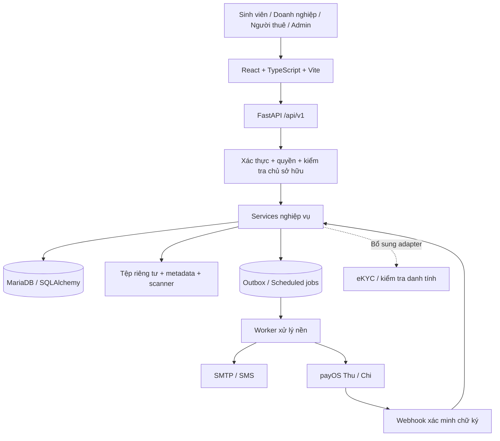
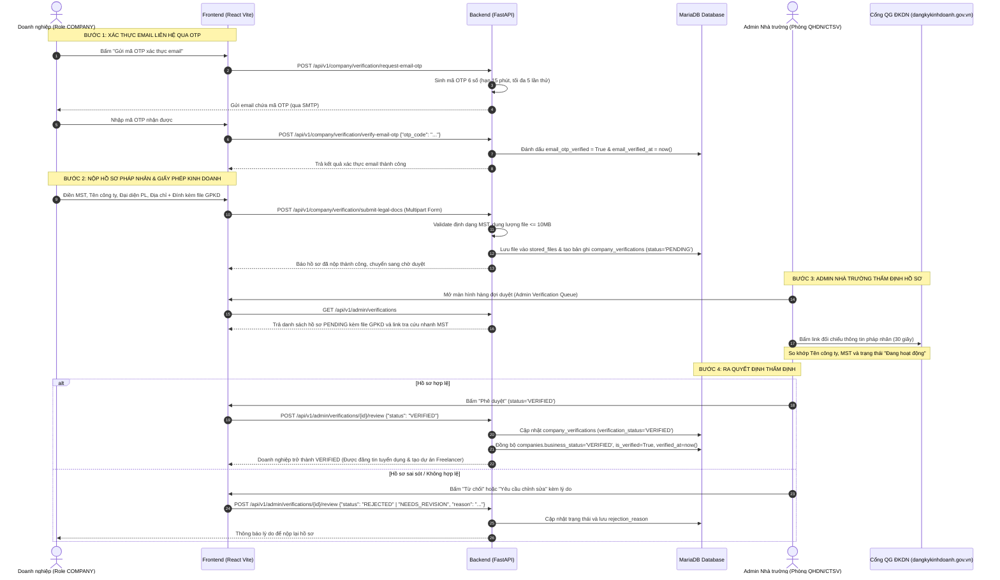

# Student Connect — Kiến trúc tổng thể để duyệt

Ngày: 09/11/2026. Phiên bản: 1.0.

**Trạng thái: bản thiết kế tổng hợp để chủ dự án duyệt, chưa phải xác nhận mọi nội dung đã được triển khai.** Tài liệu không cho phép tự động chạy migration, chuyển tiền hoặc phát hành production. Đợt này chỉ bổ sung tài liệu.

## 1. Cách đọc và phạm vi

Student Connect kết nối sinh viên, doanh nghiệp và nhà trường, gồm hai luồng độc lập nhưng dùng chung danh tính, hồ sơ và quản trị:

1. Tuyển dụng việc làm & Thực tập sinh (Job Board): doanh nghiệp xác thực → đăng tin tuyển dụng (thực tập sinh / part-time / full-time) → Nhà trường duyệt tin → sinh viên nộp CV → doanh nghiệp phỏng vấn & tiếp nhận. (Đã bỏ hoàn toàn quản lý thực tập học thuật, chấm điểm và báo cáo theo đợt).
2. Freelancer: dự án → ứng tuyển → hợp đồng riêng từng sinh viên → ký quỹ → bàn giao → nghiệm thu → giải ngân/hoàn tiền.

Quy ước trong tài liệu:

- **Hiện có:** đã có code trong bản local `tmp/fix-freelancer-a-c`; không đồng nghĩa đã merge hoặc vận hành thật.
- **Bổ sung:** thiết kế cần triển khai sau khi duyệt.
- **Cần chốt:** quyết định sản phẩm/nhà cung cấp chưa được tự coi là đã duyệt.

Tài liệu này là bản đồ tổng thể. Chi tiết database, DTO và trạng thái Freelancer tiếp tục tham chiếu đặc tả kỹ thuật. Nếu có khác biệt, không tự thay đổi code: đối chiếu, chốt quyết định và cập nhật tài liệu liên quan cùng nhau.

## 2. Những nguyên tắc nền đã thống nhất

- Mỗi doanh nghiệp có một tài khoản đại diện; không xây hệ thống nhiều nhân viên trong một doanh nghiệp ở bản đầu.
- Một tài khoản có một vai trò: STUDENT, COMPANY, CLIENT hoặc ADMIN. Nhà trường được quản trị qua các chức năng Admin và danh mục hiện có; không tự thêm một role mới từ tên đối tượng nghiệp vụ.
- CLIENT là người thuê cá nhân, không có quyền tuyển dụng doanh nghiệp hoặc trạng thái đối tác MOU.
- Một dự án có nhiều sinh viên; mỗi sinh viên có hợp đồng, milestone, ký quỹ và quyết toán riêng.
- Dự án nhỏ có thể chỉ có một milestone. Không bắt buộc chia nhiều mốc.
- Không có ví nạp/rút hoặc số dư dùng để thanh toán hợp đồng khác.
- Chỉ tích hợp payOS cho luồng tiền; mock chỉ dùng trong test, không có nút giả lập tiền ở sản phẩm.
- Xác minh đối tác MOU hỗ trợ hai phương án nghiệp vụ song song:
  1. *Phương án 1 (Ký giấy truyền thống & Thẩm định thủ công)*: Hệ thống cấp mẫu Word/PDF chuẩn; doanh nghiệp tải về, in, ký tên đóng dấu đỏ, scan/chụp gửi lên mục "Đính kèm biên bản MOU"; Admin Phòng QHDN / Phòng CTSV thẩm định con dấu và chữ ký để kích hoạt.
  2. *Phương án 2 (Ký số điện tử luồng Hybrid — Không cần API bên thứ 3)*: Hệ thống cấp file MOU điện tử đã điền sẵn thông tin và có sẵn chữ ký số của Nhà trường; doanh nghiệp tải file về, tự dùng công cụ ký số riêng của mình (Adobe Acrobat, Foxit Reader hoặc ứng dụng đi kèm USB Token) để ký số công ty vào file PDF, sau đó tải ngược file đã ký lên web. Backend tự động xác thực 2 chữ ký số hợp lệ (của Trường và Doanh nghiệp) để kích hoạt tài khoản tức thì.
- Xác minh doanh nghiệp thông thường được tinh gọn thành 2 bước cốt lõi: Xác thực Email qua OTP (không dùng SMS OTP để tránh chi phí dịch vụ bên ngoài) + Thẩm định Mã số thuế / Giấy phép kinh doanh (đối chiếu cổng quốc gia). Bỏ hoàn toàn eKYC khuôn mặt và thu thập CCCD cá nhân để giảm ma sát và tuân thủ bảo vệ dữ liệu riêng tư.
- Module Tuyển dụng tập trung thuần túy vào kết nối việc làm và thực tập sinh (Job Board: Đăng tin → Duyệt tin → Ứng tuyển với CV → Mời phỏng vấn → Kết quả). Bỏ hoàn toàn phần báo cáo thực tập theo đợt, chấm điểm và sự tham gia của Giảng viên.
- Chấp nhận hợp đồng trên web và xác minh chữ ký số MOU là hai nghiệp vụ khác nhau. Không gắn nhãn chữ ký số đã xác thực cho thao tác bấm chấp nhận.

## 3. Sơ đồ kiến trúc ứng dụng



Chọn **modular monolith**: một backend chia module theo nghiệp vụ, cùng database, worker chạy tiến trình riêng. Chưa cần microservices, message broker hoặc Kubernetes để hoàn thiện bản đầu.

Frontend chỉ hiển thị và gửi yêu cầu. Backend quyết định quyền, giá trị tiền, trạng thái và điều kiện chuyển bước. MariaDB là nguồn dữ liệu nghiệp vụ; trang chuyển hướng payOS và số liệu trên trình duyệt không phải bằng chứng thanh toán.

## 4. Các module và trách nhiệm

| Module | Trách nhiệm | Tình trạng |
|---|---|---|
| Danh tính và tài khoản | Đăng ký/đăng nhập, phiên, OTP, trạng thái tài khoản | Hiện có |
| Hồ sơ/danh mục | Sinh viên, CV, kỹ năng, doanh nghiệp, dữ liệu trường | Hiện có |
| Tuyển dụng | Tin, lưu tin, ứng tuyển, lời mời, quản lý ứng viên | Hiện có |
| Tuyển dụng & Việc làm | Đăng tin (Job Board: thực tập sinh/part-time/full-time), ứng tuyển CV snapshot, quản lý ứng viên, phỏng vấn và tiếp nhận (Đã loại bỏ hoàn toàn đợt thực tập học thuật, chấm điểm và báo cáo) | Hiện có |
| Matching | Gợi ý dựa trên dữ liệu và dịch vụ cấu hình | Hiện có; không tạo điểm AI giả khi dịch vụ chưa sẵn sàng |
| Xác minh doanh nghiệp | Hồ sơ pháp nhân, thẩm quyền đại diện, duyệt và lịch sử | Hiện có bản duyệt thủ công; bổ sung nhiều lớp ở mục 6 |
| MOU | Hồ sơ hợp tác, thời hạn, thẩm quyền, duyệt/thu hồi | Hiện có |
| Dự án/ứng tuyển Freelancer | Ngân sách, tuyển nhiều sinh viên, lựa chọn riêng | Hiện có local |
| Hợp đồng/thực hiện | Phiên bản điều khoản, chấp nhận, milestone, bàn giao/nghiệm thu | Hiện có local |
| Tài chính | Thu, sổ cái, quyết toán, chi, hoàn tiền, hạn mức, đối soát | Hiện có local; chưa nghiệm thu tiền thật |
| Hủy/tranh chấp | Thỏa thuận hủy, bằng chứng, đóng băng, quyết định và kiểm tra chéo | Hiện có local |
| Vận hành | Audit, thông báo, outbox, job và xử lý sự cố | Hiện có nền; bổ sung vận hành production |

## 5. Quyền và các trục trạng thái

Không dùng một cờ `verified` để đại diện mọi điều kiện. Các trục phải độc lập:

| Trục | Ý nghĩa |
|---|---|
| Trạng thái tài khoản | Có được đăng nhập/sử dụng hệ thống hay không |
| Xác minh Email | Có kiểm soát hộp thư liên hệ hiện tại hay không (qua OTP Email) |
| Pháp nhân | Doanh nghiệp có Giấy chứng nhận ĐKDN và MST được thẩm định hay không |
| Hoạt động doanh nghiệp | Bình thường hay đình chỉ |
| MOU | Thỏa thuận hợp tác có được duyệt/ký số và đang còn hiệu lực hay không |
| Kiểm duyệt nội dung | Tin/dự án cụ thể có được phép công khai hay không |

Backend kiểm tra cả role, trạng thái và chủ sở hữu tài nguyên ở mỗi API. Biết ID hoặc orderCode không tạo quyền truy cập. Việc duyệt tài khoản tuyển dụng cũ hiện còn tách khỏi xác minh Freelancer; **bổ sung** một dịch vụ eligibility chung để tránh hai luồng cho kết quả mâu thuẫn, nhưng phải giữ lịch sử duyệt cũ.

## 6. Xác minh doanh nghiệp tinh gọn 2 bước (Không dùng SMS OTP, không eKYC)

### 6.1. Định hướng kiến trúc tinh gọn

Hệ thống loại bỏ mô hình xác minh 3 lớp phức tạp (vốn yêu cầu eKYC khuôn mặt, quét thẻ CCCD cá nhân và gửi OTP qua SMS) vì các lý do thực tế sau:
1. **Không dùng SMS OTP:** Gửi tin nhắn SMS Brandname phát sinh chi phí viễn thông cho từng lần gửi (500 – 1.000 VNĐ/SMS) và phụ thuộc vào cổng dịch vụ SMS bên thứ ba. Hệ thống chuyển đổi toàn bộ sang **Xác thực qua Email bằng mã OTP** (vận hành qua hạ tầng SMTP nội bộ của Nhà trường hoặc dịch vụ email có sẵn, chi phí 0 đồng).
2. **Loại bỏ eKYC và thu thập CCCD cá nhân:**
   - Việc bắt buộc người đại diện hoặc chuyên viên tuyển dụng phải quét khuôn mặt và nộp CCCD tạo ra rào cản tham gia (drop-off) rất lớn, khiến doanh nghiệp ngần ngại đăng ký.
   - Tránh rủi ro pháp lý và trách nhiệm nặng nề về lưu trữ dữ liệu sinh trắc học / danh tính cá nhân theo **Nghị định 13/2023/NĐ-CP** về bảo vệ dữ liệu cá nhân.
3. **Cơ chế bảo vệ thay thế đã có sẵn trong hệ thống:**
   - Với luồng Tuyển dụng: Admin kiểm duyệt nội dung tin đăng trước khi công khai để loại trừ tin lừa đảo, cọc tiền.
   - Với luồng Freelancer: Cơ chế Ký quỹ 100% tiền (payOS Full Escrow) đảm bảo tiền công của sinh viên được giữ an toàn trước khi làm việc.

---

### 6.2. Quy trình Nhà trường xác thực Doanh nghiệp (School Admin → Company Verification Flow)



#### Chi tiết các bước kỹ thuật theo Code thực tế:
- **Bước 1: Xác thực Email liên hệ qua OTP (`POST /api/v1/company/verification/request-email-otp` & `/verify-email-otp`):**
  - Doanh nghiệp sử dụng email đã đăng ký.
  - Backend sử dụng `otp_service` sinh mã OTP ngẫu nhiên 6 chữ số, thời hạn 15 phút, giới hạn 5 lần nhập sai, gửi qua SMTP.
  - Khi xác minh đúng, cập nhật `user.email_verified_at` và `company_verifications.email_otp_verified = True`.
- **Bước 2: Nộp hồ sơ pháp nhân (`POST /api/v1/company/verification/submit-legal-docs`):**
  - Doanh nghiệp nhập: `tax_code` (Mã số thuế), `company_name` (Tên công ty), `legal_representative` (Người đại diện theo pháp luật), `business_address` (Trụ sở chính).
  - Tải lên tệp ảnh chụp hoặc scan Giấy phép kinh doanh (`license_file`: PDF/JPG/PNG, tối đa 10MB).
  - Backend kiểm tra định dạng MST regex `^[0-9]{10}(-?[0-9]{3})?$`, lưu tệp vào bảng `stored_files` và tạo bản ghi trong bảng `company_verifications` với trạng thái `PENDING`.
- **Bước 3: Nhà trường thẩm định hồ sơ (`GET /api/v1/admin/verifications` & `POST /api/v1/admin/verifications/{id}/review`):**
  - Tài khoản Admin Nhà trường (Phòng QHDN / Phòng CTSV) truy cập hàng đợi duyệt.
  - Hệ thống cung cấp sẵn đường link tra cứu trực tiếp sang *Cổng thông tin quốc gia về đăng ký doanh nghiệp*: `https://dangkykinhdoanh.gov.vn/vn/Pages/Trangchu.aspx?taxcode={tax_code}`.
  - Admin đối chiếu nhanh trong 30 giây:
    1. So khớp tên công ty và mã số thuế giữa ảnh GPKD và dữ liệu Cổng quốc gia.
    2. Đảm bảo trạng thái doanh nghiệp đang là *"Đang hoạt động"*.
  - Quyết định thẩm định:
    - *Chấp thuận (`VERIFIED`)*: Đồng bộ cập nhật `company_verifications.verification_status = 'VERIFIED'` và `companies.business_status = 'VERIFIED'`, `companies.verification_status = 'APPROVED'`, ghi nhận `verified_by = admin.id` và `verified_at = now()`.
    - *Từ chối (`REJECTED`)* hoặc *Yêu cầu bổ sung (`NEEDS_REVISION`)*: Bắt buộc kèm `reason` ghi rõ lý do (ảnh mờ, sai MST, công ty giải thể) để doanh nghiệp nhận thông báo và nộp lại.

---

### 6.3. Nâng cấp tự nguyện lên Đối tác MOU (MOU Partner)

Sau khi đã hoàn thành xác minh 2 bước cơ bản, doanh nghiệp có nhu cầu mở rộng quy mô tuyển dụng không giới hạn, ghim tin ưu tiên hoặc hưởng chính sách cấp vốn linh hoạt theo từng mốc (Milestone) cho các dự án Freelancer có thể tự nguyện lựa chọn nâng cấp lên **Đối tác MOU** thông qua 2 phương án (ký giấy scan hoặc ký số điện tử) được quy định chi tiết tại **Mục 7**.

## 7. Đối tác MOU và doanh nghiệp thông thường

### 7.1. Định vị và chính sách ưu đãi của đối tác MOU

MOU không phải lớp thay thế KYC. Đối tác MOU là danh hiệu và cấp độ ưu tiên dành cho doanh nghiệp đã đạt điều kiện pháp nhân/danh tính nền tảng, có thỏa thuận hợp tác chính thức (MOU) được xác thực với Nhà trường, còn trong thời hạn hiệu lực và không bị đình chỉ.

| Chính sách mặc định hiện có | Đã xác minh thông thường | Đối tác MOU chính thức |
|---|---:|---:|
| Dự án mở đồng thời | 5 | 20 |
| Ngân sách tối đa mỗi dự án | 20 triệu | 100 triệu |
| Ký quỹ mỗi ngày | 50 triệu | 200 triệu |
| Cấp vốn | Đầy đủ trước làm (FULL) | Có thể từng milestone (MILESTONE) |

Admin có thể cấu hình policy/override có lý do. Dự án không quá 2 triệu hiện bắt buộc FULL. CLIENT mặc định tối đa 3 dự án mở, 20 triệu/dự án và xác minh liên hệ; không được hưởng MOU.

Hệ thống hỗ trợ song song hai phương án ký kết và xác minh biên bản thỏa thuận hợp tác (MOU):

---

### 7.2. Phương án 1: Quy trình ký giấy truyền thống và thẩm định thủ công (Offline Scan & Manual Approval Flow)

Phương án truyền thống áp dụng cho các doanh nghiệp chưa trang bị giải pháp chữ ký số trực tuyến hoặc các thỏa thuận yêu cầu văn bản giấy lưu kho vật lý theo quy định hiện hành của Nhà trường.

```text
Doanh nghiệp điền thông tin đăng ký
  → Bấm "Tải mẫu MOU tại đây" (Word/PDF chuẩn của trường)
  → In ra giấy, đại diện pháp luật ký tên, đóng dấu đỏ pháp nhân
  → Chụp ảnh / quét (scan) thành file PDF / JPEG
  → Tải file đã ký lên mục "Đính kèm biên bản MOU"
  → Admin (Phòng QHDN / Phòng CTSV) vào hàng đợi duyệt thủ công
  → Đối chiếu con dấu đỏ, chữ ký đại diện, thời hạn
  → Phê duyệt: kích hoạt tài khoản đối tác (Verified / OFFICIAL_PARTNER).
```

#### Quy trình chi tiết trên phần mềm:
1. **Điền thông tin đăng ký:** Doanh nghiệp tạo tài khoản hoặc cập nhật hồ sơ doanh nghiệp (Tên công ty, Mã số thuế, Địa chỉ trụ sở, Đại diện pháp luật/chức vụ).
2. **Cung cấp mẫu văn bản:** Trên giao diện xác minh đối tác, hệ thống cung cấp một nút bấm nổi bật: **"Tải mẫu MOU tại đây"** (liên kết tải về file Word `.docx` hoặc PDF mẫu chuẩn do Phòng Quan hệ Doanh nghiệp / Phòng Công tác Sinh viên ban hành, có sẵn tiêu đề, các điều khoản khung và vị trí ký của đại diện hai bên).
3. **Ký và đóng dấu vật lý:** Doanh nghiệp tải file về, in ra giấy, người đại diện theo pháp luật (hoặc người được ủy quyền hợp pháp) ký tên, đóng dấu tròn đỏ pháp nhân của doanh nghiệp; sau đó chụp ảnh rõ nét hoặc quét (scan) toàn bộ các trang thành file PDF hoặc hình ảnh (JPEG/PNG).
4. **Đính kèm tài liệu:** Doanh nghiệp truy cập lại hệ thống, tải tệp tài liệu đã ký lên tại mục **"Đính kèm biên bản MOU"** (hỗ trợ kéo thả, giới hạn dung lượng và kiểm tra định dạng tệp).

#### Cách xác minh và thẩm định:
- **Bộ phận phụ trách:** Admin phía Nhà trường (Phòng Quan hệ Doanh nghiệp hoặc Phòng Công tác Sinh viên) được phân quyền truy cập danh sách chờ duyệt MOU (`Admin MOU Review Queue`).
- **Tiêu chí thẩm định:**
  - Tính nguyên vẹn của văn bản: Nội dung các điều khoản cam kết đúng theo mẫu chuẩn của Nhà trường, không bị tẩy xóa, cắt ghép.
  - Tính hợp lệ của con dấu: Con dấu đỏ rõ ràng, đúng tên doanh nghiệp và mã số thuế đã đăng ký.
  - Tính hợp lệ của chữ ký: Chữ ký của đúng người đại diện pháp luật ghi trên Giấy chứng nhận đăng ký doanh nghiệp (hoặc có Giấy ủy quyền hợp lệ đính kèm trong cùng hồ sơ).
  - Thời hạn hiệu lực: Xác định ngày ký kết, ngày bắt đầu và ngày kết thúc hiệu lực của biên bản thỏa thuận.
- **Quyết định thẩm định:**
  - *Chấp thuận (`Approved`)*: Admin nhập ngày hiệu lực, ngày hết hạn và bấm duyệt. Hệ thống cập nhật trạng thái biên bản thành `VERIFIED`, nâng cấp doanh nghiệp lên tier `OFFICIAL_PARTNER`, kích hoạt tài khoản đạt trạng thái `Verified` và tự động áp dụng các hạn mức ưu đãi đối tác.
  - *Yêu cầu chỉnh sửa (`Needs Revision`) / Từ chối (`Rejected`)*: Admin ghi rõ lý do (dấu mờ, sai người ký, thiếu trang, văn bản sửa đổi nội dung...) để doanh nghiệp nhận thông báo và tải lại bản thay thế.

---

### 7.3. Phương án 2: Ký số điện tử luồng "Hybrid" (Tải lên file đã ký sẵn — Không cần API bên thứ ba)

Phương án tối ưu toàn diện cho giai đoạn phát triển và vận hành thực tế: **Đảm bảo tính pháp lý tuyệt đối 100% theo Luật Giao dịch điện tử 2023, tự động kích hoạt zero-touch, nhưng loại bỏ hoàn toàn việc phải tích hợp cổng API phức tạp hoặc tốn phí duy trì từ các nhà mạng bên thứ ba.**

```text
Doanh nghiệp đăng ký hồ sơ pháp nhân
  → Hệ thống tự động sinh file PDF MOU (điền sẵn thông tin 2 bên + đóng sẵn Chữ ký số của Trường)
  → Doanh nghiệp bấm: "Tải file MOU bản gốc (đã có chữ ký của Trường)"
  → Doanh nghiệp tự mở file trên máy tính bằng Adobe Acrobat / Foxit / App USB Token
  → Cắm USB Token hoặc dùng chứng thư số của công ty ký đè vào ô Bên B
  → Doanh nghiệp tải file đã ký lên mục: "Tải lên file MOU đã ký số"
  → Backend tự động chạy hàm Validate (kiểm tra 2 chữ ký số X.509 + đối soát MST) trong 1 giây
  → Hợp lệ: Hệ thống tự động kích hoạt tài khoản Verified / Đối tác MOU ngay lập tức!
```

#### Quy trình chi tiết trên phần mềm:
1. **Tự động sinh văn bản và ký trước từ Nhà trường:**
   - Hệ thống tự động trích xuất thông tin doanh nghiệp (Tên công ty, Mã số thuế, Đại diện pháp lý, Địa chỉ) điền vào template MOU PDF chuẩn.
   - Bản PDF này đã được Nhà trường ký số sẵn bằng Chứng thư số của Trường (sử dụng chứng thư số CA nội bộ hoặc chứng thư số đã cấu hình sẵn của Nhà trường).
2. **Doanh nghiệp tải về máy tính:**
   - Trên giao diện xác minh đối tác, hệ thống cung cấp nút bấm: **"Tải file MOU bản gốc (đã có chữ ký của Trường)"**.
   - Doanh nghiệp tải tệp `.pdf` về máy tính của mình.
3. **Doanh nghiệp tự ký số bằng công cụ của họ (Offline Signing):**
   - Doanh nghiệp mở file PDF bằng các phần mềm đọc/ký PDF tiêu chuẩn và phổ biến nhất (Adobe Acrobat Reader, Foxit Reader, hoặc phần mềm quản lý USB Token của Viettel/VNPT/FPT/MISA mà họ đang dùng hàng ngày để khai thuế).
   - Doanh nghiệp cắm USB Token (hoặc chọn chứng thư số có sẵn trên máy), chọn vùng ký Bên B và nhập mã PIN để ký số.
   - Nhờ cơ chế *Incremental Updates* của chuẩn PAdES, chữ ký của Doanh nghiệp được ghi tiếp vào file PDF mà không làm ảnh hưởng đến chữ ký số trước đó của Nhà trường.
4. **Tải lên và xác thực tự động (Upload & Automated Validation):**
   - Doanh nghiệp quay lại website, bấm nút **"Tải lên file MOU đã ký số"** và chọn file PDF vừa hoàn tất.
   - Ngay khi nhận file, backend tự động thực thi module kiểm tra mật mã học (cryptographic verification) mà không cần gọi API ra bên ngoài:
     * Kiểm tra số lượng chữ ký: File bắt buộc phải có đủ **2 chữ ký số** (của Nhà trường và của Doanh nghiệp).
     * Kiểm tra tính toàn vẹn: Cả chữ ký của Trường và chữ ký của Doanh nghiệp đều nguyên vẹn (`intact`), văn bản không bị sửa đổi sau khi ký.
     * Đối soát danh tính: Trích xuất trường Mã số thuế (`UID`/`serial_number`) từ chứng thư số X.509 của Chữ ký thứ 2, so khớp 100% với Mã số thuế của tài khoản doanh nghiệp.
   - Kết quả: Nếu hợp lệ, hệ thống lập tức kích hoạt trạng thái `VERIFIED` và nâng cấp lên tier `OFFICIAL_PARTNER` trong vòng 1 giây; nếu không hợp lệ (sai mã số thuế, thiếu chữ ký, file bị chỉnh sửa), hệ thống báo lỗi cụ thể để doanh nghiệp ký lại.

#### 7.3.1. Thiết kế kỹ thuật kiểm tra (Validate) chữ ký số tại Backend (Không phụ thuộc API ngoài)

Module thẩm định được cài đặt trực tiếp trong Backend Python thông qua các thư viện mật mã học mã nguồn mở tiêu chuẩn quốc tế (`pyHanko` và `cryptography`):

1. **Độc lập hoàn toàn (Zero external API dependency):** Không cần mua gói API, không cần đăng ký tài khoản đối tác với VNPT, Viettel hay DocuSign, loại bỏ rủi ro timeout mạng hoặc lỗi dịch vụ từ bên thứ ba.
2. **Tương thích toàn diện (Universal CA Compatibility):** Doanh nghiệp sử dụng chữ ký số của bất kỳ nhà cung cấp CA nào tại Việt Nam (Viettel, VNPT, FPT, MISA, BKAV, SmartSign...) đều được hệ thống tự động nhận diện và giải mã chứng thư số X.509 theo chuẩn chung.
3. **Bảo mật và chống gian lận:**
   - Chống tráo đổi tài liệu: Vì file gốc tải về đã có sẵn chữ ký số của Trường kèm thông tin MST của doanh nghiệp, doanh nghiệp không thể lấy file mẫu trắng điền tên công ty khác để ký.
   - Chống sửa đổi nội dung: Nếu doanh nghiệp dùng công cụ can thiệp sửa đổi các điều khoản hay số tiền, chữ ký số của Nhà trường sẽ bị hỏng ngay lập tức và backend từ chối duyệt.

---

### 7.4. Thiết kế kỹ thuật, lưu trữ và bảo vệ tính toàn vẹn MOU

1. **Chuẩn định dạng tệp:**
   - Biên bản ký giấy: Quét lưu dưới dạng PDF chuẩn (PDF/A-1b) hoặc ảnh chất lượng cao (tối thiểu 300 DPI), dung lượng tối đa 15MB/tệp.
   - Biên bản ký số: Chuẩn PAdES (PDF Advanced Electronic Signatures) với cấu hình LTV (Long-Term Validation), nhúng kèm chứng thư, CRL/OCSP response và Timestamp TSA, đảm bảo giá trị pháp lý dài hạn ngay cả khi chứng thư số gốc hết hạn nhiều năm sau đó.
2. **Lưu trữ bảo mật:** Toàn bộ tệp MOU (cả bản scan giấy và bản e-sign) được lưu tại vùng lưu trữ tệp riêng tư (Private Storage/S3-compatible bucket), tuyệt đối không mở quyền public trực tiếp. Quyền tải xuống hoặc xem trước được cấp qua API có xác thực quyền (Admin phụ trách hoặc chính doanh nghiệp chủ sở hữu) thông qua đường dẫn ký tạm thời (Presigned URL) có thời hạn tối đa 15 phút.
3. **Mã băm và chống giả mạo:** Lưu trữ `sha256_hash` của tệp vào cơ sở dữ liệu ngay khi tải lên hoặc sau khi ký số hoàn tất. Mọi lần tải tệp đều kiểm tra tính nhất quán với hash đã lưu.
4. **Quản lý vòng đời và hết hạn:**
   - Trường `valid_from` và `valid_until` được ghi nhận chính thức trong bảng `mou_agreements`.
   - Hệ thống quét định kỳ (scheduled job hàng ngày): Trước khi MOU hết hạn 30 ngày và 7 ngày, gửi thông báo nhắc nhở doanh nghiệp tái ký.
   - Khi quá hạn: Chuyển trạng thái MOU sang `EXPIRED`. Doanh nghiệp tự động chuyển từ tier `OFFICIAL_PARTNER` về `VERIFIED` thông thường; các dự án và hợp đồng đã giao kết trước đó tiếp tục thực hiện bình thường, nhưng các dự án mới sẽ áp dụng hạn mức chuẩn 5 dự án / 20 triệu VND.
5. **Nhật ký kiểm toán (Audit Trail):**
   - Với Phương án 1: Lưu `reviewed_by_user_id`, `reviewed_at`, `decision_notes`, `original_filename`, `file_size`, `sha256_hash`.
   - Với Phương án 2: Lưu `provider_transaction_id`, `signer_cert_serial`, `signer_common_name`, `signer_tax_code`, `issuer_ca`, `signed_at`, `timestamp_authority`, `signer_ip_address`, `validation_result_json`.

## 8. Luồng tuyển dụng việc làm & thực tập tinh gọn (Recruitment Portal)

Phân hệ Tuyển dụng được tinh gọn hoàn toàn thành một sàn kết nối việc làm (Job Board) tiêu chuẩn. **Bỏ toàn bộ các quy trình học thuật rườm rà (quản lý thực tập theo đợt của trường, nộp báo cáo định kỳ, chấm điểm và sự tham gia của Giảng viên hướng dẫn)** để tối ưu hóa trải nghiệm kết nối và giảm tải vận hành.

```text
Doanh nghiệp hoàn thiện xác minh 2 bước (hoặc Đối tác MOU)
  → Tạo tin tuyển dụng (Thực tập sinh / Part-time / Full-time)
  → Kiểm duyệt tin: Admin duyệt (Doanh nghiệp thường) hoặc Tự động duyệt (Doanh nghiệp MOU)
  → Sinh viên duyệt danh sách tin, xem chi tiết → Ứng tuyển với CV snapshot
  → Doanh nghiệp quản lý ứng viên trên Dashboard:
       [Đã nhận CV] → [Phù hợp / Mời phỏng vấn] → [Nhận việc] hoặc [Từ chối]
  → Sinh viên nhận kết quả ứng tuyển qua thông báo trên web và email.
```

### 8.1. Các bước chi tiết trong luồng tuyển dụng:
1. **Tạo tin tuyển dụng:** Doanh nghiệp nhập tiêu đề công việc, phân loại (Thực tập sinh / Bán thời gian / Toàn thời gian), mô tả công việc, yêu cầu kỹ năng, mức lương/trợ cấp, địa điểm làm việc và hạn nộp hồ sơ.
2. **Kiểm duyệt nội dung (Job Moderation):**
   - Với Doanh nghiệp thường: Mọi tin đăng đều chuyển vào hàng đợi duyệt của Admin để kiểm tra tính xác thực, ngăn chặn tin tuyển dụng lừa đảo, cọc tiền hoặc đa cấp.
   - Với Đối tác MOU: Tin đăng được tự động phê duyệt (Auto-approve) và tự động ghim lên vị trí nổi bật (Top Featured Jobs).
3. **Nộp hồ sơ ứng tuyển:** Sinh viên chọn CV đã tải lên hoặc hồ sơ trực tuyến trên hệ thống để ứng tuyển. Hệ thống chụp lại bản sao (CV snapshot) tại thời điểm nộp để bảo đảm tính toàn vẹn dữ liệu.
4. **Quản lý và tương tác ứng viên:**
   - Doanh nghiệp xem danh sách ứng viên, lọc theo trạng thái.
   - Khi chọn "Mời phỏng vấn": Doanh nghiệp nhập lịch hẹn, địa điểm hoặc đường link họp trực tuyến. Hệ thống tự động gửi thông báo cho sinh viên.
   - Sau phỏng vấn, doanh nghiệp cập nhật trạng thái "Nhận việc" (Offer Accepted) hoặc "Từ chối" kèm lời nhắn động viên.

### 8.2. Ranh giới vận hành và bảo vệ quyền riêng tư:
- **Không có ký quỹ (Escrow):** Luồng tuyển dụng không giữ tiền trên hệ thống; tiền lương/phụ cấp do doanh nghiệp chi trả trực tiếp cho sinh viên theo thỏa thuận lao động ngoài đời thực.
- **Bảo vệ thông tin cá nhân:** Thông tin nhạy cảm của sinh viên (số điện thoại, CCCD, địa chỉ cư trú) chỉ được mở cho doanh nghiệp xem sau khi doanh nghiệp gửi lời mời phỏng vấn chính thức.
- **Cơ chế báo cáo vi phạm (Report):** Trên mỗi tin tuyển dụng luôn có nút "Báo cáo vi phạm" để sinh viên phản ánh các hành vi sai trái (thu phí tuyển dụng, mô tả sai sự thật), giúp Admin kịp thời khóa tài khoản doanh nghiệp vi phạm.

## 9. Luồng Freelancer từ đầu đến cuối

1. Người thuê đủ điều kiện tạo nháp: yêu cầu, kỹ năng, ngân sách, số sinh viên, lịch, milestone và tiêu chí nghiệm thu.
2. Backend kiểm tra hạn mức; Admin duyệt nội dung dự án trước công khai.
3. Sinh viên ứng tuyển với đề xuất, giá và thời gian. Người thuê đánh giá/chọn từng người.
4. Mỗi lựa chọn tạo một hợp đồng riêng. Tổng cam kết dự án phải nằm trong ngân sách đã duyệt; tăng ngân sách/số sinh viên đi qua yêu cầu mở rộng.
5. Hai bên chấp nhận cùng phiên bản điều khoản/hash. Bên đưa offer đã chấp nhận phiên bản đó; bên còn lại chấp nhận để hợp đồng hiệu lực.
6. Cấp vốn từng milestone qua một payment order riêng. FULL yêu cầu đủ tiền cho các milestone thuộc phạm vi áp dụng trước bắt đầu.
7. Sinh viên thực hiện và nộp sản phẩm/tệp có phiên bản. Người thuê yêu cầu sửa hoặc nghiệm thu theo điều khoản.
8. Nghiệm thu tạo nghĩa vụ quyết toán; chưa có nghĩa sinh viên đã nhận tiền.
9. Worker gửi lệnh chi và xác nhận kết quả; chỉ ghi đã chi khi có bằng chứng provider phù hợp.
10. Đóng hợp đồng khi công việc và nghĩa vụ tiền đã giải quyết; đóng dự án khi ngừng tuyển và mọi hợp đồng liên quan đủ điều kiện.

Một mốc vẫn đi đủ các bước. Nhiều sinh viên không dùng chung hợp đồng hoặc tự chia chung một khoản thu.

Điều khoản phí, thời gian review, grace, số lần sửa và chính sách hủy được snapshot. Thay policy toàn hệ thống không sửa hồi tố hợp đồng. Worker xử lý quá hạn/tự nghiệm thu chỉ theo điều khoản đã chấp nhận và phải kiểm tra tranh chấp/hold.

## 10. Tiền, ký quỹ và payOS

```text
Người thuê → kênh Thu payOS → tài khoản ngân hàng thu
→ backend xác nhận khoản thu → sổ cái + escrow theo milestone
→ nghiệm thu/quyết định hợp lệ → settlement + dự trữ khoản chi
→ kênh Chi payOS → ngân hàng sinh viên hoặc bên được hoàn
→ xác nhận thực chi → ghi sổ + cập nhật quyết toán.
```

“Escrow/ký quỹ” trong phần mềm là sổ theo dõi nghĩa vụ và tiền dành cho hợp đồng; không tự chứng minh ngân hàng/payOS cung cấp tài khoản escrow độc lập. Trước production phải xác nhận mô hình thu/giữ/chi được các bên liên quan chấp thuận.

- Trang return/cancel chỉ dẫn người dùng về đơn. Backend xác minh webhook và đối chiếu dữ liệu provider; không tin `success=true` hoặc HTTP 200.
- Tiền VND nguyên; ID và tiền lớn trả dạng chuỗi JSON. Không dùng float cho phép tính tài chính.
- Khoản thiếu, thừa, lặp hoặc trễ vào hàng đợi kiểm tra; không tự cộng nhiều lần để cấp vốn milestone.
- Sổ cái kép bất biến, ghi cân bằng; sửa sai bằng bút toán điều chỉnh phù hợp, không sửa/xóa giao dịch đã ghi.
- Phí mặc định 5%, snapshot theo hợp đồng. Backend tính gross/fee/net trước xác nhận; phí ngân hàng/provider được ghi chi phí riêng.
- Timeout/UNKNOWN: giữ dự trữ, truy vấn cùng reference; không tạo lệnh mới chỉ vì chưa có phản hồi.
- Quyết toán SPLIT có nhánh chi/hoàn riêng, theo dõi từng kết quả. Một nhánh thành công không khiến nhánh còn lại tự thành công.
- Tài khoản ngân hàng người nhận được kiểm tra, số tài khoản mã hóa và dùng snapshot khi chi. Admin xem số đầy đủ phải có lý do/audit.
- Cập nhật 12/11/2026 theo yêu cầu đơn giản hóa demo: tài khoản thu và ví chi có thể khác; bỏ tải chứng từ/duyệt treasury. Worker kiểm tra số dư PayOS, thông báo admin khi thấp/thiếu và tự chờ nạp tiền. Không tự tạo bút toán nạp vốn; sổ nguồn chi không đại diện số dư ví thực. Xem [quy trình hiện tại](PAYOUT_BALANCE_WORKFLOW.md).

Người dùng xem “đã ký quỹ/đang giữ/chờ giải ngân/đã chi/đã hoàn” theo hợp đồng. Không hiển thị thành ví có thể rút hoặc dùng chéo.

## 11. Hủy, tranh chấp và đình chỉ

- Hủy theo thỏa thuận hoặc quyền được điều khoản cho phép; không tự mở quyền hủy đơn phương mới ở frontend.
- Hồ sơ tranh chấp gắn đúng milestone/hợp đồng, có thời hạn bằng chứng, người xử lý và lịch sử quyết định.
- Hold là lý do chặn tài chính cụ thể; đóng tranh chấp phải kiểm tra còn hold khác hay không.
- Quyết định tài chính có phê duyệt thứ hai khi policy yêu cầu; cấm tự duyệt quyết định của mình.
- Frontend của bên tranh chấp không đọc được quyết định Admin còn nháp.
- Đình chỉ doanh nghiệp không tự xác định ai sở hữu tiền; xử lý hợp đồng và hoàn/chi theo hồ sơ có bằng chứng.

## 12. Kiến trúc dữ liệu và transaction

Các nhóm dữ liệu chính:

| Nhóm | Quan hệ cốt lõi |
|---|---|
| Tài khoản/hồ sơ | User → Student/Company/Client; Company.user_id duy nhất |
| Tuyển dụng | Company → Job → Application → Student/CV snapshot |
| Xác minh/hợp tác | Company → nhiều lần nộp hồ sơ → tài liệu/quyết định; Company → MOU có thời hạn |
| Freelancer | Project → nhiều Application và Contract; mỗi Contract → một Student và nhiều Milestone |
| Thực hiện | Contract versions, chấp nhận, deliverable versions, review |
| Tài chính | Milestone → payment orders/receipts; settlement → nhiều transfer legs; journals → postings |
| Ngoại lệ | Cancellation, dispute, evidence, decisions và holds |
| Vận hành | Audit, command idempotency, outbox, scheduled jobs, reconciliation |

Hiện migration local đến **0004**, có 92 bảng ứng dụng; số lượng này không bao gồm các bảng bổ sung đa lớp mới đề xuất. MariaDB là đích triển khai, SQLite chỉ phục vụ một số test/demo; phải test migration và concurrency trên MariaDB.

Service quản lý transaction; router xác thực đầu vào và gọi nghiệp vụ. Lệnh ghi quan trọng có idempotency và lock theo thứ tự nhất quán. Writer tài chính dùng finance gate trước các khóa nghiệp vụ liên quan. Không giữ transaction DB trong lúc chờ network provider.

Outbox lưu ý định trong cùng transaction với nghiệp vụ. Worker thực hiện bên ngoài rồi cập nhật kết quả trong transaction mới. Chấp nhận giao lại thông điệp; handler phải chống xử lý trùng. Không khẳng định “exactly once” cho network.

## 13. API và frontend

- API gốc `/api/v1`; DTO/OpenAPI là hợp đồng làm việc chung. Hiện còn cả response raw và envelope theo module; frontend đã có adapter. Chuẩn hóa sau phải có kế hoạch tương thích.
- Lệnh tiền/điều khoản dùng idempotency phù hợp, kiểm tra version/hash và ownership ở server.
- Frontend chia feature; giữ các khu vực tuyển dụng việc làm (Job Board), CV snapshot bên cạnh Freelancer (Không có menu/giao diện đợt thực tập học thuật).
- Điểm vào Freelancer: `/student/freelancer`, `/company/freelancer`, `/client/freelancer`, `/admin/freelancer`.
- `/onboarding` dùng token hạn chế 15 phút, không thay phiên đăng nhập thông thường. Bổ sung checklist đa lớp tại đây và trong tài khoản đang hoạt động.
- Admin cần hàng đợi theo bước, bằng chứng, lịch sử và lý do; không có một nút “xác minh tất cả” bỏ qua kiểm tra.
- UI phân biệt trạng thái công việc, escrow và giao dịch chi. Đã nghiệm thu không được render thành đã nhận tiền.
- File tải qua API có quyền; không biến uploads thành thư mục public hoặc gửi đường dẫn máy chủ cho người dùng.

## 14. Tích hợp ngoài và cấu hình

| Tích hợp | Ranh giới cấu hình | Hiện trạng |
|---|---|---|
| payOS Thu | Credentials backend, webhook, return/cancel URL | Adapter local có; cần cấu hình và nghiệm thu thật |
| payOS Chi | Credentials riêng, nguồn chi, hạn mức/quyền dịch vụ | Adapter local có; cần xác nhận tài khoản và thử thật |
| Email OTP & Thông báo | SMTP / Service adapter (Gmail/Resend/SMTP trường), domain gửi | Có nền; sử dụng để xác thực tài khoản thay thế SMS (chi phí 0 đồng) |
| SMS OTP | Không sử dụng | **Đã loại bỏ** nhằm tránh phát sinh chi phí viễn thông và phụ thuộc nhà mạng |
| Scanner | Kiểm tra tệp và cập nhật trạng thái | Cần dịch vụ thật; không mặc định tệp CLEAN |
| eKYC khuôn mặt / CCCD | Không sử dụng | **Đã loại bỏ** để giảm ma sát đăng ký và tuân thủ Nghị định 13/2023/NĐ-CP |
| Tra cứu doanh nghiệp | Nguồn chính thức `dangkykinhdoanh.gov.vn` qua Admin link | Thẩm định thủ công nhanh 30s (chi phí 0 đồng) |
| Chữ ký số / E-Sign MOU | Không cần API bên thứ ba (Dùng thư viện nội bộ `pyHanko` / `cryptography`) | **Luồng Hybrid:** Doanh nghiệp tự ký offline qua Adobe/Foxit/Token rồi tải lên; backend tự động validate 2 chữ ký số X.509; không tốn phí duy trì API |

Secrets chỉ ở backend `.env`/secret store; `.env.example` chỉ là mẫu. `VITE_*` là cấu hình công khai, không chứa khóa payOS hoặc secret backend. Đổi URL không đủ nếu provider chưa cấp quyền, webhook không truy cập được hoặc worker chưa chạy.

## 15. Bảo mật và dữ liệu riêng tư

- Mật khẩu hash; token/refresh, giới hạn thử và thu hồi theo cơ chế hiện có, cần review bảo mật trước phát hành.
- OTP có thời hạn, giới hạn thử/gửi; đổi liên hệ vô hiệu kết quả cũ theo mục đích.
- HTTPS, CORS chỉ domain cần thiết, giới hạn request và chống dò tài nguyên.
- Mã hóa số ngân hàng; tài liệu pháp nhân/danh tính chỉ reviewer và chủ hồ sơ có quyền phù hợp.
- Không ghi secrets, OTP, số ngân hàng đầy đủ hoặc ảnh giấy tờ vào log. Audit lưu hành động/kết quả/tham chiếu, không sao chép toàn bộ dữ liệu nhạy cảm.
- eKYC cần thông báo mục đích, phạm vi xử lý, quyền truy cập và thời hạn lưu trước khi mở thu thập; ưu tiên lưu provider reference/kết quả tối thiểu.
- Tệp có giới hạn dung lượng/loại, cách ly trước quét, tải có quyền, backup và chính sách xóa/lưu giữ phù hợp.
- Tách quyền vận hành và xét duyệt tài chính theo chức năng; hiện role ADMIN chưa đồng nghĩa đã có đầy đủ phân quyền nhân sự chi tiết. MFA cho Admin là hạng mục tăng cường trước production.

## 16. Triển khai và vận hành

Mô hình production đề xuất: reverse proxy HTTPS → frontend build + API; worker riêng; MariaDB mạng nội bộ; vùng lưu tệp riêng tư; scanner; các provider ngoài. Có thể dùng Docker Compose trên một máy chủ ở giai đoạn đầu, nhưng phải có backup ngoài máy chủ và giám sát.

Ba môi trường tách biệt: development, staging, production. Không trộn credentials, DB, webhook hoặc dữ liệu nhận dạng giữa môi trường. Staging không gọi tiền thật trừ ca thử được cho phép và kiểm soát cụ thể.

Quy trình phát hành: review → test/lint/build → backup → kiểm tra migration trên bản sao → triển khai migration tương thích → API/worker/frontend → smoke test → giám sát. Không rollback migration tài chính bằng cách xóa dữ liệu; ưu tiên bản sửa tiến và khôi phục có kế hoạch.

Giám sát tối thiểu: API lỗi, worker heartbeat, outbox tồn, job lỗi, webhook bị từ chối, khoản thu chưa phân bổ, transfer UNKNOWN, thiếu nguồn chi, ledger lệch và backlog xác minh. Có runbook xử lý, người phụ trách và nhật ký can thiệp.

## 17. Hiện trạng và phần còn thiếu

| Hạng mục | Đánh giá ở thời điểm lập bản |
|---|---|
| Nền tuyển dụng việc làm & hồ sơ CV | Có code; cần đợt regression toàn hệ thống riêng |
| Backend Freelancer và adapter tài chính | Đã triển khai local; chưa merge/push, chưa nghiệm thu tài khoản thật |
| Frontend Freelancer | Đã nối API theo 21 màn hình thiết kế; cần chủ dự án duyệt trải nghiệm |
| Xác minh doanh nghiệp 2 bước (Mục 6) | Đã tinh gọn: OTP Email + Giấy phép kinh doanh/MST; loại bỏ hoàn toàn SMS OTP và eKYC khuôn mặt/CCCD |
| Xác minh đối tác MOU (2 phương án) | Đã quy hoạch: Phương án 1 (ký giấy scan + Admin duyệt) và Phương án 2 (Ký số luồng Hybrid không cần API bên thứ 3, backend dùng pyHanko validate tự động) |
| Vận hành production/backup/monitoring | Cần hoàn thiện và nghiệm thu môi trường triển khai |

Bằng chứng kiểm thử đợt trước: 67 test frontend, 9 test trình duyệt fixture, 1 luồng trình duyệt với backend thật và 413 test backend đã đạt ở mốc ghi nhận; thay đổi đọc preview phí sau đó có 38 test tập trung đạt. Đây là lịch sử kiểm thử local, không phải kết quả chạy lại trong đợt viết tài liệu hoặc xác nhận tiền thật.

## 18. Thứ tự thực hiện sau khi duyệt

1. Chốt các quyết định mục 19, cập nhật đặc tả xác minh dùng chung và ma trận quyền tuyển dụng/Freelancer.
2. Chốt DTO, schema và migration đa lớp; xác định cách chuyển dữ liệu doanh nghiệp cũ. Không tự nâng hồ sơ cũ thành đã eKYC.
3. Triển khai dịch vụ eligibility chung, kiểm tra từng lớp, audit và luồng thay người đại diện.
4. Làm checklist doanh nghiệp và hàng đợi Admin; kiểm thử các cách vượt bước ở backend.
5. Nối provider được chọn, kiểm tra callback, timeout, xác minh lại, chống trùng và dữ liệu riêng tư.
6. Duyệt frontend toàn luồng; regression tuyển dụng việc làm và Freelancer trên staging.
7. Xác nhận mô hình tiền và cấu hình payOS; thử thu/chi số nhỏ có kiểm soát, đối soát ngân hàng/provider/ledger.
8. Review và commit nhánh riêng, review nhóm rồi merge; hoàn thành vận hành trước khi mở production.

Các file dùng chung cần phối hợp: router registry, auth/roles, Company/User, eligibility, migrations, OpenAPI và navigation. Phân việc theo module nhưng phải thống nhất DTO/trạng thái trước; không để mỗi thành viên tạo một cờ xác minh riêng.

## 19. Các quyết định đã thống nhất và cần chủ dự án duyệt

1. **Điều kiện tối thiểu (Đã chốt tinh gọn):** Doanh nghiệp chỉ cần hoàn thành 2 bước: Xác thực Email qua OTP (chi phí 0 đồng) + Nộp Mã số thuế và ảnh Giấy phép kinh doanh (Admin đối chiếu cổng quốc gia trong 30s) trước khi được duyệt đăng tin tuyển dụng hoặc tạo dự án Freelancer.
2. **Loại bỏ SMS OTP & eKYC/CCCD:** Thống nhất không dùng SMS OTP (tránh chi phí nhà mạng) và không thu thập CCCD/eKYC khuôn mặt (tránh rào cản tham gia và rủi ro pháp lý theo Nghị định 13/2023/NĐ-CP). An toàn được bảo đảm qua payOS Full Escrow và Admin duyệt tin.
3. **Phân hệ Tuyển dụng tinh gọn:** Đã chốt cắt bỏ hoàn toàn việc quản lý thực tập theo đợt, báo cáo học thuật, chấm điểm và sự tham gia của Giảng viên. Module chỉ tập trung làm cổng kết nối việc làm & thực tập sinh tiêu chuẩn (Job Board).
4. **Phương thức ký kết và xác minh MOU:** Hỗ trợ song song Phương án 1 (Ký giấy tải mẫu scan và duyệt thủ công qua Phòng QHDN/CTSV) và Phương án 2 (Ký số điện tử luồng Hybrid: Trường ký sẵn → Doanh nghiệp tự ký offline qua Adobe/Foxit/Token → Tải lên web → Backend tự động validate 2 chữ ký số X.509; không cần tích hợp cổng API của bên thứ ba).
5. **Hạn mức dự án Freelancer:** Điều chỉnh sát thực tế sinh viên: Client tối đa 5 triệu, Doanh nghiệp thường tối đa 15–20 triệu, Đối tác MOU tối đa 30–50 triệu (cho nhóm làm đồ án).

Các con số hạn mức ở mục 7 đang là mặc định hiện có; thay đổi các số này là quyết định policy riêng. Chấp thuận tài liệu tổng thể không tự cấp quyền chạy giao dịch thật hoặc migration lên DB đang dùng.

## 20. Tài liệu chi tiết liên quan

- [README dự án](../README.md)
- [Đặc tả backend/database Freelancer](../backend/docs/FREELANCER_BACKEND_SPEC_PAYOS.md)
- [Triển khai backend local](../backend/docs/freelancer/BACKEND_IMPLEMENTATION.md)
- [Triển khai payOS](../backend/docs/freelancer/PAYOS_IMPLEMENTATION.md)
- [OpenAPI Freelancer](../backend/docs/freelancer/openapi.json)
- [Frontend và hướng dẫn chạy](../frontend/docs/FREELANCER_IMPLEMENTATION.md)
- [Mô tả màn hình](../backend/docs/freelancer/FRONTEND_SCREEN_BRIEF.md)

Nguồn tham chiếu công khai cho hướng xác minh đa lớp, đã tra trong phiên trao đổi: [TopCV — tìm việc an toàn](https://www.topcv.vn/tim-viec-an-toan), [TopCV — hướng dẫn eKYC](https://insider.tophr.vn/xac-thuc-ekyc-tang-cuong-bao-mat-gia-tang-uy-tin-thuong-hieu-tuyen-dung/). Chúng là tham khảo sản phẩm, không chứng minh dự án đã tích hợp dịch vụ của TopCV hoặc có cùng quy trình nội bộ.

---

## 21. Đặc tả Kỹ thuật Triển khai & Danh mục Nâng cấp / Sửa lỗi (Dành cho Lập trình viên & AI Agent)

Mục này cung cấp đầy đủ hợp đồng API, cấu trúc Database, quy tắc kiểm tra và danh mục các lỗi đã phát hiện để đội ngũ lập trình (hoặc AI coding agent như Claude Code) đọc và triển khai trực tiếp vào mã nguồn mà không cần phỏng đoán.

### 21.1. Phân hệ 1: Xác minh doanh nghiệp 2 bước (Verification)

#### A. Database Schema: Bảng `company_verifications`
```sql
CREATE TABLE IF NOT EXISTS company_verifications (
    id INT AUTO_INCREMENT PRIMARY KEY,
    company_id INT NOT NULL UNIQUE,
    tax_code VARCHAR(20) NOT NULL,
    company_name VARCHAR(255) NOT NULL,
    legal_representative VARCHAR(100) NOT NULL,
    business_address VARCHAR(255) NOT NULL,
    license_file_id INT NULL,                      -- Khóa ngoại trích xuất sang bảng stored_files
    email_otp_verified TINYINT(1) DEFAULT 0,
    email_otp_code_hash VARCHAR(255) NULL,         -- Lưu hash bcrypt/sha256 của OTP, không lưu mã gốc
    email_otp_expires_at DATETIME NULL,
    email_otp_attempts INT UNSIGNED DEFAULT 0,
    verification_status VARCHAR(20) DEFAULT 'PENDING', -- PENDING, VERIFIED, REJECTED, NEEDS_REVISION
    reviewer_user_id INT NULL,
    reviewed_at DATETIME NULL,
    rejection_reason TEXT NULL,
    created_at DATETIME DEFAULT CURRENT_TIMESTAMP,
    updated_at DATETIME DEFAULT CURRENT_TIMESTAMP ON UPDATE CURRENT_TIMESTAMP,
    CONSTRAINT fk_comp_verif_company FOREIGN KEY (company_id) REFERENCES companies(id) ON DELETE CASCADE
);
```

#### B. API Endpoints:
1. `POST /api/v1/company/verification/request-email-otp`:
   - Quyền: `COMPANY` đã đăng nhập.
   - Hành vi: Sinh mã OTP ngẫu nhiên 6 chữ số, thời hạn 15 phút, gửi qua email công ty, ghi vào `email_otp_code`.
2. `POST /api/v1/company/verification/verify-email-otp`:
   - Payload: `{ "otp_code": "123456" }`
   - Hành vi: Kiểm tra mã OTP và hạn dùng. Nếu đúng, đặt `email_otp_verified = 1`.
3. `POST /api/v1/company/verification/submit-legal-docs`:
   - Payload: `multipart/form-data` gồm `tax_code`, `company_name`, `legal_representative`, `business_address`, `license_file` (tệp ảnh/PDF).
   - Hành vi: Lưu tệp vào `stored_files`, tạo hoặc cập nhật bản ghi `company_verifications` ở trạng thái `PENDING`.
4. `GET /api/v1/admin/verifications`:
   - Quyền: `ADMIN`.
   - Hành vi: Lấy danh sách hàng đợi các doanh nghiệp đang chờ duyệt xác minh, kèm đường link tra cứu nhanh:  
     `https://dangkykinhdoanh.gov.vn/vn/Pages/Trangchu.aspx` (kèm tham số `tax_code`).
5. `POST /api/v1/admin/verifications/{id}/review`:
   - Quyền: `ADMIN`.
   - Payload: `{ "status": "VERIFIED" | "REJECTED" | "NEEDS_REVISION", "reason": "..." }`
   - Hành vi: Cập nhật `company_verifications` và cập nhật `companies.business_status = 'VERIFIED'`.

---

### 21.2. Phân hệ 2: Xác minh đối tác MOU luồng Hybrid (E-Sign)

#### A. Database Schema: Bảng `mou_agreements`
```sql
CREATE TABLE IF NOT EXISTS mou_agreements (
    id INT AUTO_INCREMENT PRIMARY KEY,
    company_id INT NOT NULL,
    mou_type VARCHAR(20) NOT NULL,                 -- 'PAPER_SCAN' hoặc 'HYBRID_DIGITAL_SIGN'
    file_id INT NOT NULL,                          -- Khóa ngoại sang stored_files
    sha256_hash VARCHAR(64) NOT NULL,
    school_signed_at DATETIME NULL,
    company_signed_at DATETIME NULL,
    signer_tax_code VARCHAR(20) NULL,
    signer_common_name VARCHAR(255) NULL,
    certificate_issuer VARCHAR(255) NULL,
    valid_from DATE NOT NULL,
    valid_until DATE NOT NULL,
    status VARCHAR(20) DEFAULT 'PENDING',          -- PENDING, VERIFIED, REJECTED, EXPIRED, REVOKED
    reviewer_user_id INT NULL,                     -- Dành cho duyệt tay ở Phương án 1 (ký giấy)
    reviewed_at DATETIME NULL,
    created_at DATETIME DEFAULT CURRENT_TIMESTAMP,
    CONSTRAINT fk_mou_company FOREIGN KEY (company_id) REFERENCES companies(id) ON DELETE CASCADE
);
```

#### B. Thư viện Python yêu cầu (Backend `requirements.txt`):
- `pyHanko>=0.20.0`: Xử lý phân tích cấu trúc nhị phân PDF và thẩm định chữ ký số PAdES.
- `cryptography>=41.0.0`: Giải mã chứng thư số X.509 và trích xuất `Subject DN` (Mã số thuế, Tên công ty).

#### C. API Endpoints:
1. `GET /api/v1/company/mou/template/paper`:
   - Quyền: `COMPANY`.
   - Hành vi: Tải về file mẫu Word/PDF chuẩn của Nhà trường để in ra ký đóng dấu đỏ (Phương án 1).
2. `POST /api/v1/company/mou/submit-paper-scan`:
   - Quyền: `COMPANY`.
   - Payload: `multipart/form-data` chứa file scan giấy (PDF/JPG/PNG).
   - Hành vi: Lưu file, tạo bản ghi `mou_agreements` với `mou_type = 'PAPER_SCAN'`, chuyển vào hàng đợi Admin duyệt thủ công.
3. `GET /api/v1/company/mou/template/hybrid-signed`:
   - Quyền: `COMPANY`.
   - Hành vi: Sinh động file PDF MOU đã điền sẵn Tên công ty, MST và đóng sẵn Chữ ký số điện tử của Nhà trường; trả về stream PDF để doanh nghiệp tải về máy tính tự ký (Phương án 2).
4. `POST /api/v1/company/mou/upload-hybrid-signed`:
   - Quyền: `COMPANY`.
   - Payload: `multipart/form-data` chứa file PDF đã được doanh nghiệp ký số đè bằng công cụ của họ.
   - **Xử lý Backend:**
     1. Gọi hàm `validate_pdf_signature` qua `pyHanko`.
     2. Xác nhận có tối thiểu 2 chữ ký số: Chữ ký 1 của Trường và Chữ ký 2 của Doanh nghiệp.
     3. Xác minh chữ ký nguyên vẹn (`intact = True`), không bị chỉnh sửa nội dung trái phép.
     4. Trích xuất Mã số thuế trong chứng thư số X.509 của Chữ ký 2, so khớp với `tax_code` của doanh nghiệp.
     5. Nếu hợp lệ: Cập nhật `mou_agreements.status = 'VERIFIED'`, nâng cấp `companies.tier = 'OFFICIAL_PARTNER'` ngay tức thì mà không cần Admin duyệt tay.

---

### 21.3. Phân hệ 3: Tuyển dụng việc làm & Thực tập sinh tinh gọn (Job Board)

#### A. Database Schema: Bảng `jobs` và `job_applications`
```sql
CREATE TABLE IF NOT EXISTS jobs (
    id INT AUTO_INCREMENT PRIMARY KEY,
    company_id INT NOT NULL,
    title VARCHAR(255) NOT NULL,
    job_type VARCHAR(30) NOT NULL,                 -- 'INTERNSHIP', 'PART_TIME', 'FULL_TIME'
    location VARCHAR(255) NOT NULL,
    salary_range VARCHAR(100) NULL,                -- Ví dụ: '3 - 5 triệu/tháng', 'Thỏa thuận'
    description TEXT NOT NULL,
    requirements TEXT NOT NULL,
    benefits TEXT NULL,
    status VARCHAR(20) DEFAULT 'PENDING_REVIEW',   -- PENDING_REVIEW, PUBLISHED, CLOSED, REJECTED
    is_featured TINYINT(1) DEFAULT 0,              -- Tự động ghim 1 nếu là Đối tác MOU
    deadline DATE NULL,
    created_at DATETIME DEFAULT CURRENT_TIMESTAMP,
    updated_at DATETIME DEFAULT CURRENT_TIMESTAMP ON UPDATE CURRENT_TIMESTAMP,
    CONSTRAINT fk_jobs_company FOREIGN KEY (company_id) REFERENCES companies(id) ON DELETE CASCADE
);

CREATE TABLE IF NOT EXISTS applications (
    id INT AUTO_INCREMENT PRIMARY KEY,
    job_id INT NOT NULL,
    student_id INT NOT NULL,
    cv_id INT NOT NULL,
    cv_snapshot_url VARCHAR(500) NULL,             -- Đường dẫn/URL CV snapshot tại thời điểm nộp
    cover_letter TEXT NULL,
    current_status VARCHAR(30) DEFAULT 'SUBMITTED', -- SUBMITTED, REVIEWING, INTERVIEW_INVITED, ACCEPTED, REJECTED
    interview_time DATETIME NULL,
    interview_location VARCHAR(255) NULL,          -- Địa điểm hoặc link Google Meet / Zoom
    interview_notes TEXT NULL,
    applied_at DATETIME DEFAULT CURRENT_TIMESTAMP,
    updated_at DATETIME DEFAULT CURRENT_TIMESTAMP ON UPDATE CURRENT_TIMESTAMP,
    CONSTRAINT fk_app_job FOREIGN KEY (job_id) REFERENCES jobs(id) ON DELETE CASCADE,
    CONSTRAINT fk_app_student FOREIGN KEY (student_id) REFERENCES students(id) ON DELETE CASCADE
);
```

#### B. API Endpoints:
1. `POST /api/v1/jobs`:
   - Quyền: `COMPANY` (đã `VERIFIED`).
   - Hành vi: Tạo tin tuyển dụng mới. Nếu công ty có MOU còn hiệu lực: Đặt `status = 'PUBLISHED'` và `is_featured = 1` (Auto-approve). Nếu là công ty thường: Đặt `status = 'PENDING_REVIEW'` (chờ Admin duyệt).
2. `GET /api/v1/jobs`:
   - Quyền: Public (Sinh viên & Khách).
   - Hành vi: Danh sách các tin `PUBLISHED`, sắp xếp ưu tiên các tin `is_featured = 1` lên đầu, hỗ trợ lọc theo ngành nghề, vị trí, từ khóa.
3. `POST /api/v1/jobs/{id}/apply`:
   - Quyền: `STUDENT`.
   - Payload: `{ "cv_file_id": ..., "cover_letter": "..." }`
   - Hành vi: Tạo bản ghi `job_applications`.
4. `GET /api/v1/company/jobs/{id}/applications`:
   - Quyền: `COMPANY` chủ sở hữu tin đăng.
   - Hành vi: Lấy danh sách hồ sơ ứng viên đã nộp.
5. `PATCH /api/v1/company/applications/{id}/status`:
   - Quyền: `COMPANY` chủ sở hữu.
   - Payload: `{ "status": "INTERVIEW_INVITED", "interview_time": "...", "interview_location": "..." }`
   - Hành vi: Cập nhật trạng thái và bắn thông báo tới sinh viên.

---

### 21.4. Danh mục Fix lỗi & Nâng cấp Giao diện (Rút ra từ Báo cáo Kiểm thử Thực tế)

Khi rà soát toàn bộ mã nguồn, cần ưu tiên khắc phục các điểm nghẽn kỹ thuật và hoàn thiện trải nghiệm giao diện sau:

1. **Khắc phục lỗi Modal không đóng khi gặp mã lỗi 409 (Frontend):**
   - *Hiện trạng:* Trong các thao tác bấm duyệt, giải ngân hoặc kích hoạt milestone, nếu Backend trả về HTTP `409 Conflict` (ví dụ `MILESTONE_NOT_FUNDED`), modal Radix UI tiếp tục mở và bị kẹt trạng thái chờ (loading spinner).
   - *Yêu cầu:* Bổ sung xử lý `onError` bắt lỗi 409, tự động mở Toast thông báo màu đỏ hiển thị rõ nội dung lỗi (`detail`), đồng thời đóng hoặc khôi phục trạng thái nút bấm trong Modal để người dùng có thể thao tác lại.
2. **Xử lý triệt để bài toán Cấp vốn Milestone (Funding Policy):**
   - *Hiện trạng:* Khi hợp đồng được tạo ở chế độ `FundingPolicy.FULL`, milestone đầu tiên có thể rơi vào trạng thái `NOT_FUNDED` dẫn đến việc sinh viên bấm "Bắt đầu làm" bị chặn với lỗi 409.
   - *Yêu cầu:* Backend phải kiểm tra tính nhất quán giữa trạng thái thanh toán của Payment Order và trạng thái cấp vốn của Milestone (`is_funded = True` khi xác nhận thanh toán payOS thành công).
3. **Nâng cấp Giao diện Doanh nghiệp (Company Portal UI Upgrade):**
   - Xây dựng lại trang **Onboarding & Xác minh:** Hiển thị rõ tiến trình 2 bước (Bước 1: OTP Email -> Bước 2: Nộp GPKD).
   - Nút nổi bật **"Nâng cấp Đối tác MOU"**: Modal cho phép chọn giữa (1) Tải mẫu giấy in scan nộp; hoặc (2) Tải file đã ký sẵn của Trường -> Hướng dẫn ký số bằng Adobe/Foxit -> Tải file đã ký lên.
   - Tích hợp trình xem trước PDF Viewer (nhúng trực tiếp xem văn bản MOU ngay trên màn hình web).
4. **Cơ chế Mock payOS cho môi trường Local Development:**
   - Trong môi trường local (`PAYOS_COLLECTION_ENABLED=false`), xây dựng một router mock nội bộ hoặc nút bấm dành riêng cho môi trường phát triển để giả lập webhook thanh toán thành công (Success callback simulation), giúp kiểm thử toàn bộ luồng tiền từ đầu đến cuối mà không bị lỗi 503 cấu hình payOS.
5. **Hiển thị Toast & Thông báo Lỗi Thống nhất:**
   - Rà soát các component Axios / React Query trong thư mục `frontend/src/features/` để bảo đảm mọi response có mã lỗi HTTP (400, 401, 403, 404, 409, 422, 500) đều được bắt bởi interceptor và hiển thị thông báo thân thiện tới người dùng thay vì ghi log im lặng ở console.
